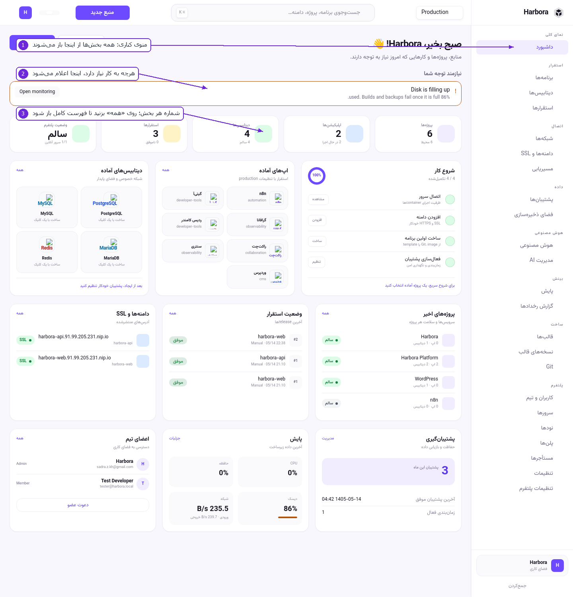
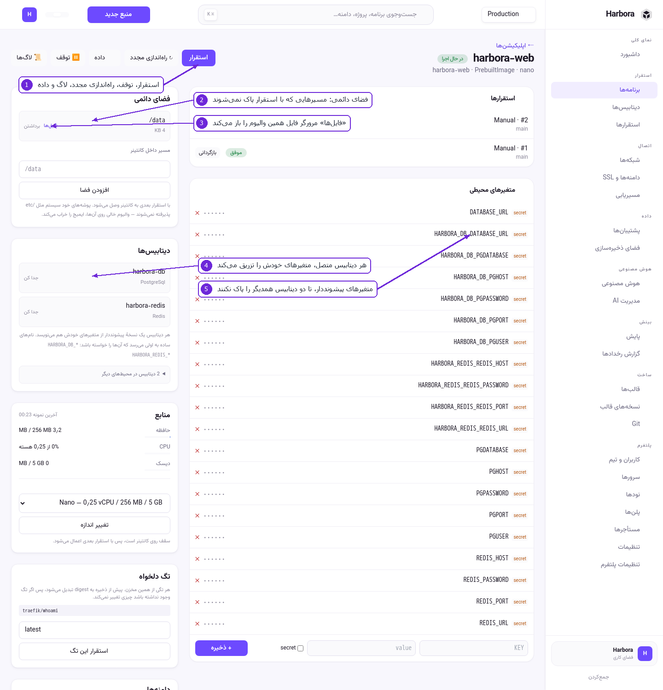
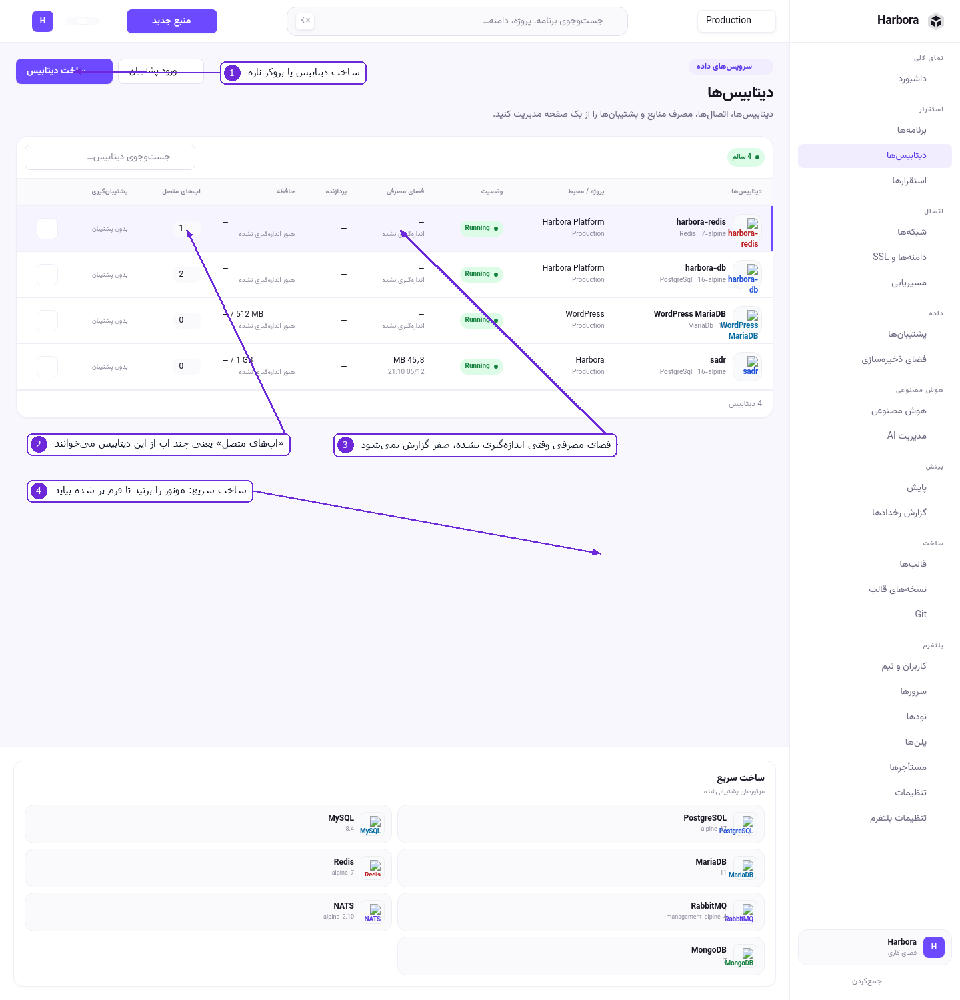
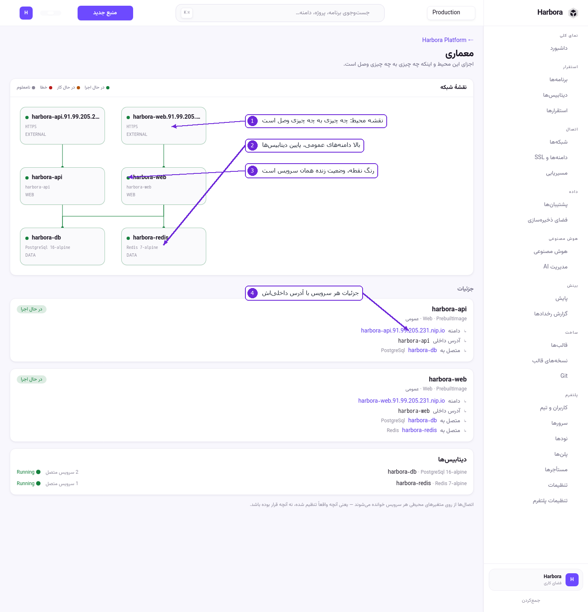
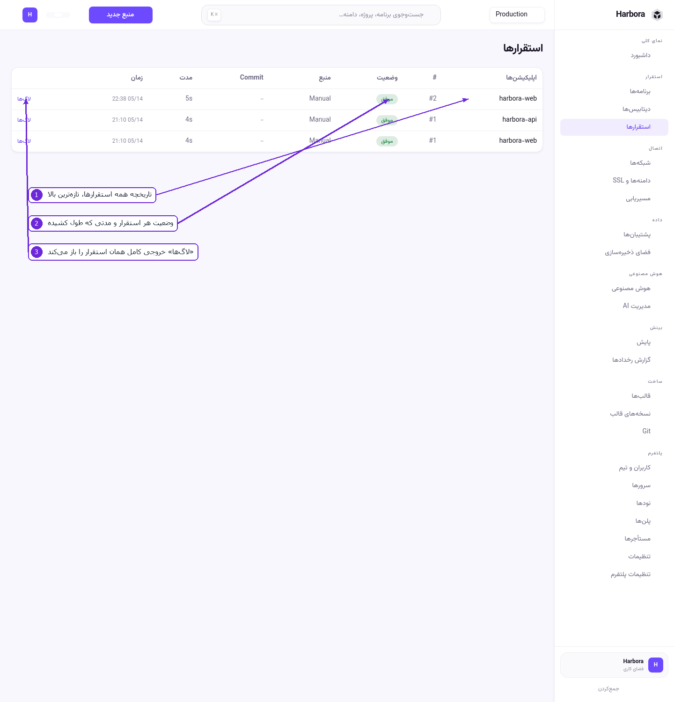
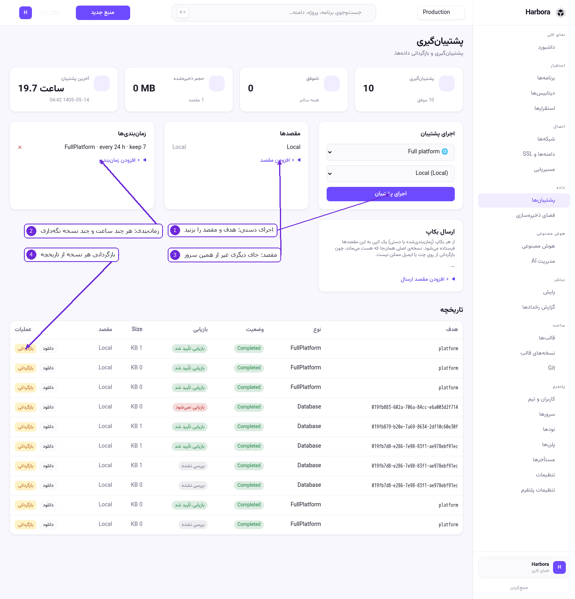

<div align="center">



<br>

[](https://github.com/sadrazkh/Harbora/releases/latest)
[](https://github.com/sadrazkh/Harbora/actions/workflows/ci.yml)
[](https://github.com/sadrazkh/Harbora/commits/master)
[](https://github.com/sadrazkh/Harbora/stargazers)

**فارسی** · [English](README.md) · [📖 آموزش تصویری](docs/tutorial) · [🧩 فانکشن‌ها](docs/functions.md) · [📕 رانبوک](deploy/RUNBOOK.md)

### با یک دستور نصب می‌شود، هرچه دارید رویش اجرا می‌شود، و بعد می‌توانید بفروشیدش.

[](#-معماری)
[](#-معماری)
[](#-معماری)
[](#-معماری)

</div>

<div dir="rtl">

## 💎 چرا هاربورا؟

<table>
  <tr>
    <td width="50%">⚡ <b>یک دستور، روی یک VPS خالی</b><br>نصب‌کننده پیش‌نیازهایش را خودش می‌آورد، داکر را نصب می‌کند، درباره‌ی دامنه می‌پرسد یا به <code>nip.io</code> بدون DNS برمی‌گردد، کلیدهای تازه می‌سازد، از سورس بیلد می‌کند و بعد <b>خودش را راستی‌آزمایی می‌کند</b>: Traefik، مسیر پنل و گواهی SSL.</td>
    <td width="50%">🏢 <b>یک کسب‌وکار، نه فقط یک داشبورد</b><br>پلن، سهمیه، زمان‌بند ظرفیت‌آگاه، شبکه‌ی ایزوله‌ی هر مستأجر، اندازه‌گیری ساعتی و موجودی پیش‌پرداخت. به مشتری یک ورک‌اسپیس می‌دهید و او فقط مالِ خودش را می‌بیند.</td>
  </tr>
  <tr>
    <td>🚀 <b>هرچه دارید را دیپلوی کنید</b><br>مخزن گیت با Dockerfile یا بدون آن (buildpack زبان را تشخیص می‌دهد)، استک Compose، سایت استاتیک، ایمیج آماده، قالب یک‌کلیکی، یا پوشه‌ای که از لپ‌تاپتان می‌فرستید.</td>
    <td>🧩 <b>کد، بدون هیچ ریپازیتوری</b><br>C# و JavaScript و Python را در خود پنل بنویسید. مسیر HTTP، زمان‌بندی cron، رویدادهای پلتفرم و پیام‌های صف — با همان خط لوله‌ای بیلد و منتشر و بازگردانده می‌شوند که هر اپ دیگری دارد.</td>
  </tr>
  <tr>
    <td>🔐 <b>نودهایی که هیچ پورتی باز نمی‌کنند</b><br>نود به پنل وصل می‌شود، پس افزودنش نه فایروال می‌خواهد نه IP عمومی نه port-forward. توکن یک‌بارمصرف، بعد mTLS. پنل فعل‌های نام‌دار از یک allowlist ثابت می‌فرستد، نه دستور shell.</td>
    <td>🤖 <b>دستیاری که اول می‌پرسد</b><br>به فارسی یا انگلیسی بگویید چه می‌خواهید. با ابزارهای فقط‌خواندنی نگاه می‌کند، هر تغییر را به برنامه‌ای تبدیل می‌کند که شما تأیید کنید، و رمزی را که پشت دکمه‌ی قفل وارد کنید هرگز نمی‌بیند.</td>
  </tr>
</table>

## 📸 یک نگاه به پنل

<table>
  <tr>
    <td width="50%"><br><b>📊 داشبورد:</b> چه چیزی رسیدگی می‌خواهد، و سرور چه حالی دارد</td>
    <td width="50%"><br><b>📦 یک اپ:</b> دیپلوی‌ها، متغیرها، دامنه‌ها، والیوم‌ها، لاگ، بازگشت</td>
  </tr>
  <tr>
    <td><br><b>🗄 دیتابیس‌ها:</b> ساخته، رمزدارشده و با یک کلیک قابل اتصال</td>
    <td><br><b>🕸 معماری:</b> چه چیزی با چه چیزی حرف می‌زند، از روی شبکه‌ی واقعی</td>
  </tr>
  <tr>
    <td><br><b>🚀 استقرارها:</b> لاگ زنده‌ی بیلد، جای صف، لغو، بازگشت</td>
    <td><br><b>💾 پشتیبان‌ها:</b> زمان‌بندی‌شده، نگه‌داشته، ارسال‌شده، قابل بازیابی</td>
  </tr>
</table>

<sub>تصویرها از خودِ پنل‌اند، با علامت‌گذاری. رابط کاربری دوزبانه است — فارسی و English، راست‌چین و چپ‌چین.</sub>

## 🎯 از کد تا اپ در حال اجرا

اپتان را نوشته‌اید. کد را به هاربورا بدهید؛ دیتابیس، اتصال، استقرار و بررسی سالم بودن را خودش انجام می‌دهد. چیزی برای یاد گرفتن نیست و هوش مصنوعی هم در کار نیست.

**در پنل:** **راه انداختن اپ** (`/launch`) را باز کنید، آدرس گیت یا یک zip بدهید، صفحه‌ای را بخوانید که می‌گوید چه پیدا کرده، چه می‌سازد و چقدر هزینه دارد، و **راه بینداز** را بزنید. آخرش آدرس اپ را می‌بینید، یا دقیقاً قدمی را که ایستاد و کاری را که باید بکنید.

**از ترمینال:**

```bash
cd my-app
harbora launch
```

تنها چیزی که از کدتان خواسته می‌شود: متغیرهایی را که می‌گیرد (`DATABASE_URL`، `REDIS_URL`، …) بخواند و روی `0.0.0.0` گوش بدهد. راهنمای یک‌صفحه‌ای: **[docs/tutorial/15-launch.md](docs/tutorial/15-launch.md)**. هنوز پنل ندارید؟ پایین‌تر نصبش کنید.

## 🚀 نصب با یک دستور

روی یک **VPS لینوکسی تازه** (اوبونتو / دبیان / فدورا / آلپاین)، به‌عنوان root:

```bash
curl -fsSL https://raw.githubusercontent.com/sadrazkh/Harbora/master/deploy/install.sh | sudo bash
```

همین. نصب‌کننده **خودکفا و تعاملی است (فارسی/English)** و **idempotent** — اجرای دوباره‌اش بی‌خطر است؛ فایل `.env` موجود (کلیدهای شما) هرگز بازنویسی نمی‌شود و استکِ در حال اجرا دوباره استفاده می‌شود.

<details>
<summary><b>قدم‌به‌قدم چه می‌کند</b></summary>

۱. سازگاری سیستم‌عامل و معماری را بررسی می‌کند.
۲. **هر پیش‌نیازی را خودش نصب می‌کند** — `curl`، `git`، `openssl` و **داکر** (با Compose) اگر نباشند.
۳. **می‌پرسد دامنه‌ی واقعی دارید یا نه** (و `panel.` و `apps.` را از آن می‌سازد)، وگرنه به `nip.io` بدون DNS برمی‌گردد.
۴. **DNS را تست می‌کند** برای پنل و وایلدکارد اپ‌ها — و اگر رکوردها به این سرور اشاره نمی‌کنند شفاف هشدار می‌دهد. می‌توانید ادامه دهید و بعداً DNS را درست کنید.
۵. **ایمیل Let's Encrypt** را می‌پرسد (خالی = پیش‌فرض معقول).
۶. فایل `/opt/harbora/app/deploy/.env` را با کلیدهای تصادفیِ تازه می‌سازد.
۷. **پلتفرم را از سورس بیلد** و اجرا می‌کند: Traefik v3.6، PostgreSQL، MinIO برای فضای ذخیره‌سازی، و خود پنل — به‌علاوه‌ی یک کانتینر Redis که هیچ‌چیز از آن استفاده نمی‌کند (بخش [معماری](#-معماری)).
۸. **نصب را راستی‌آزمایی می‌کند**: سازگاری Traefik با Docker API، مسیر پنل از داخل Traefik (۴۰۴ یک راه‌حل دوزبانه‌ی روشن چاپ می‌کند)، و صدور SSL (در صورت شکست، خطوط لاگ ACME و دلیل‌های محتمل را نشان می‌دهد).

</details>

### 🌐 پیش‌فرض بدون DNS — همین‌طوری کار می‌کند

اگر هیچ دامنه‌ای ندهید، هاربورا از وایلدکارد **`nip.io`** روی IP عمومی سرور استفاده می‌کند — مثلاً `panel.203.0.113.10.nip.io`. **بدون هیچ تنظیم DNS** رزولو می‌شود، پس بلافاصله یک پنل HTTPS سالم دارید. برای امتحان‌کردن عالی است.

### 🏷 دامنه‌ی اختصاصی، برای پروداکشن

اول DNS را به سرور بدهید:

| رکورد | به کجا | برای چه |
|---|---|---|
| `panel.example.com` | IP سرور شما | خود پنل |
| `*.apps.example.com` | IP سرور شما | هر اپی که دیپلوی می‌کنید |

بعد بدون تعامل نصب کنید:

```bash
PANEL_DOMAIN=panel.example.com \
ROOT_DOMAIN=apps.example.com \
ACME_EMAIL=you@example.com \
  curl -fsSL https://raw.githubusercontent.com/sadrazkh/Harbora/master/deploy/install.sh | sudo bash
```

اگر به‌جای pipe در یک ترمینال اجرایش کنید، همین‌ها را **می‌پرسد** و پیش‌فرض‌ها را نشان می‌دهد.

<details>
<summary><b>🔒 SSL چطور کار می‌کند، و چرا وایلدکارد لازم نیست</b></summary>

Traefik گواهی‌ها را از **Let's Encrypt با چالش HTTP-01** می‌گیرد: دامنه‌ی پنل و **هر دامنه‌ی اپ، گواهی خودش را خودکار می‌گیرد** در اولین درخواست HTTPS، چون هر مسیری که هاربورا می‌سازد `certresolver: letsencrypt` دارد.

دو شرط: DNS آن دامنه باید به سرور اشاره کند، و **پورت ۸۰ باید از اینترنت در دسترس باشد** — چالش از همان‌جا رد می‌شود. گواهی **وایلدکارد** (`*.apps.example.com`) فقط با چالش DNS-01 و کلید API ارائه‌دهنده ممکن است، و این طراحیِ زیردامنه‌ای به آن نیازی ندارد.

</details>

## 🔄 به‌روزرسانی و 🗑 حذف

```bash
# به‌روزرسانی به آخرین سورس و بیلد دوباره:
curl -fsSL https://raw.githubusercontent.com/sadrazkh/Harbora/master/deploy/install.sh | sudo bash -s -- update

# حذف (قبل از پاک‌کردن دیتا می‌پرسد):
curl -fsSL https://raw.githubusercontent.com/sadrazkh/Harbora/master/deploy/install.sh | sudo bash -s -- uninstall
```

<details>
<summary><b>↩️ هر به‌روزرسانی را می‌شود برگرداند</b></summary>

قبل از اینکه یک به‌روزرسانی هر مهاجرتی روی دیتابیس اعمال کند، هاربورا از دیتابیس دامپ می‌گیرد و **اگر دامپ شکست بخورد مهاجرت را انجام نمی‌دهد**. تغییر اسکیمای بی‌بازگشت، همان یک قدمِ به‌روزرسانی است که برگرداندنی نیست؛ پس لحظه‌ای که هنوز می‌شود نقطه‌ی بازگشت گرفت، همان لحظه‌ای است که باید اصرار کرد. روی نصب تازه (چیزی برای از دست دادن نیست) و ری‌استارت معمولی (چیزی عوض نمی‌شود) دامپی گرفته نمی‌شود.

```bash
harbora backups                     # فهرست نقطه‌های بازگشت؛ pre-upgrade-* خودکارند
harbora backup-db                   # همین حالا یکی بگیرید، قبل از کار پرخطر
harbora restore-db <file>           # دیتابیس را برگردانید (نام دیتابیس را می‌پرسد)
```

`restore-db` قبل از جایگزینی، دیتابیس فعلی را به‌صورت `pre-restore-*` ذخیره می‌کند، پس بازگرداندن از روی فایل اشتباه هم قابل جبران است. اگر هاستی واقعاً نتواند دامپ بگیرد، `HARBORA_SKIP_UPGRADE_BACKUP=1` اجازه می‌دهد به‌روزرسانی بدون آن جلو برود.

به‌روزرسانی هرگز `deploy/.env` را بازنویسی نمی‌کند، ولی تنظیم‌هایی را که نسخه‌های جدید لازم دارند و فایل شما ندارد **اضافه** می‌کند — مهم‌تر از همه `HARBORA_MASTER_KEY`. بدون آن، پنل اصلاً بالا نمی‌آید (به‌جای اینکه کلیدها را قابل رمزگشایی رها کند، بسته شکست می‌خورد) و این دقیقاً شبیه «به‌روزرسانی همه‌چیز را خراب کرد» به‌نظر می‌رسد. اگر چنین شد: **`harbora doctor`**.

</details>

## ▶️ اولین اجرا

۱. آدرس **`https://<دامنه‌ی-پنل>/setup`** را باز کنید و حساب **مالک** بسازید — یعنی خودتان، ارائه‌دهنده.
۲. تمام. تا وقتی چیزی در فضای کاری نیست، داشبورد یک پیشنهاد دارد: **شروع کن**، یعنی همان راه انداختن اپ. بعد از آن اپ‌ها، استقرارها و منابع سرور را نشان می‌دهد.

> **⏱ تست ۶۰ ثانیه‌ای.** **Apps → Full form** → منبع *Prebuilt image* → ایمیج `nginx:alpine`، پورت `80`، سایز `nano`، دامنه `test.<root-domain>` → **Save** → **Deploy**. لاگ زنده را ببینید، بعد دامنه را باز کنید: nginx، با گواهی معتبر.

راهنمای قدم‌به‌قدم در **[deploy/RUNBOOK.md](deploy/RUNBOOK.md)** و گردش تصویری پنل در **[docs/tutorial](docs/tutorial)**.

## ✨ امکانات

<details open>
<summary><b>🚀 دیپلوی و بیلد</b></summary>

- **راه انداختن اپ**: آدرس گیت، zip یا یک پوشه می‌دهید و یک صفحه می‌گوید چه پیدا کرده، چه می‌سازد و چقدر هزینه دارد. با یک دکمه دیتابیس‌ها ساخته می‌شوند، با همان نام‌هایی که کدتان می‌خواند وصل می‌شوند، اپ مستقر می‌شود، و چیزی بررسی می‌شود که یک استقرار سبز ثابت نمی‌کند: اپ بالا مانده، هر دیتابیس روی شبکهٔ اپ جواب می‌دهد، آدرسش از بیرون کار می‌کند و لاگش شکایتی ندارد. راهنما: **[docs/tutorial/15-launch.md](docs/tutorial/15-launch.md)**.
- **دیپلوی** از مخزن گیت (با Dockerfile **یا بدون آن** — buildpack خودکار Node / .NET / Go / PHP / Python / استاتیک را تشخیص می‌دهد)، Dockerfile، **استک Docker Compose**، سایت استاتیک، ایمیج آماده، آپلود با CLI، یا **قالب** یک‌کلیکی.
- **یکپارچگی گیت**: اتصال GitHub/GitLab/Gitea با توکن **یا OAuth**؛ دیپلوی روی push/tag با وبهوک تأییدشده با HMAC؛ متادیتای کامیت، تاریخچه، بازگشت.
- **طراح بصری مسیریابی**: قوانین کشیدنی، مسیریابی host/path، کلید SSL، HTTP→HTTPS، وب‌سوکت، basic-auth، هدر سفارشی، پیش‌نمایش زنده‌ی کانفیگ Traefik.

</details>

<details open>
<summary><b>🗄 داده، پشتیبان و پایش</b></summary>

- **سرویس‌های مدیریت‌شده**: شش دیتابیس — PostgreSQL، MySQL، MariaDB، Redis، MongoDB، Meilisearch — و دو صف پیام، **RabbitMQ** و **NATS**. هر هشت‌تا یک‌جور ساخته می‌شوند: کلیدهایی که Harbora خودش می‌سازد و رمز می‌کند، جا روی شبکه‌ی خصوصی همان محیط، و اتصال یک‌کلیکی که connection string را داخل اپ تزریق می‌کند.
- **بکاپ**: کانفیگ اپ، والیوم/دیتابیس، کل پلتفرم؛ لوکال + سازگار با S3؛ زمان‌بندی‌شده؛ نگه‌داری؛ ارسال نسخه به **تلگرام یا ایمیل**؛ دانلود؛ بازیابی.
- **مانیتورینگ و هشدار**: متریک هاست/کانتینر، نمودار زنده‌ی CPU، سلامت اپ، هشدار دیسک/بکاپ/کرش؛ اطلاع‌رسانی با ایمیل / تلگرام / دیسکورد / وبهوک.

</details>

<details open>
<summary><b>🧩 فانکشن‌ها — کد بدون ریپازیتوری</b></summary>

- کد را در خود پنل بنویسید — **C#، JavaScript یا Python** — و اجرا می‌شود؛ بدون ریپازیتوری، بدون Dockerfile و بدون `git push`. یک **فانکشن‌اپ** میزبان چند فانکشن است، پس بیست فانکشن ده‌خطی هزینه‌ی یک اپ nano را دارند نه بیست‌تا.
- چهار راه برای تریگرشدن: مسیر **HTTP**، **زمان‌بندی cron**، **رویدادهای پلتفرم** (پایان یا شکست دیپلوی، کرش، شکست بکاپ، عبور از آستانه، موجودی کم، push و tag گیت، تغییرهای ورک‌اسپیس و عضو) و **پیام‌های صف** از یک سرویس RabbitMQ، با نامه‌های مرده‌ای که جایی دیده می‌شوند.
- «انتشار» کل build context را می‌سازد و به همان خط لوله‌ی دیپلوی معمولی می‌دهد، پس لاگ زنده، health check، جابه‌جایی بدون قطعی، بازگشت، سهمیه و اندازه‌گیری همان‌هایی است که هر اپ دیگری دارد — و خطای کامپایل، سرِ انتشار، در لاگ بیلد دیده می‌شود. هر اجرا ثبت می‌شود: تریگر، وضعیت، مدت.
- راهنما: **[docs/functions.md](docs/functions.md)**.

</details>

<details>
<summary><b>🖧 نود، چندمستأجری و بقیه</b></summary>

- **ایجنت نود**: سرویسی که **هیچ پورت ورودی باز نمی‌کند** — نود به پنل وصل می‌شود، پس ثبت یک نود نه فایروال می‌خواهد نه IP عمومی، و پشت NAT کار می‌کند. توکن یک‌بارمصرف، بعد mTLS با CA خود پنل؛ ابطال، چرخش و ثبت دوباره از رابط کاربری. پنل **فعل‌های نام‌دار از allowlist ثابت** می‌فرستد، نه دستور shell.
- **PaaS چندمستأجری**: پلن، سایز نمونه، سهمیه، زمان‌بند ظرفیت‌آگاه، کنسول ارائه‌دهنده، ایزولاسیون شبکه، اندازه‌گیری مصرف.
- **دسترسی به قابلیت‌ها**: مالک تعیین می‌کند هر قابلیتِ فروختنی برای چه کسانی فعال باشد — بر اساس **پلن** و **هر ورک‌اسپیس**. ورک‌اسپیسی که آن را ندارد باز هم **می‌بیندش**: خاکستری، با قفل، و صفحه‌ای که می‌گوید چه کسی می‌تواند روشنش کند. هر قفل روی سرور اعمال می‌شود؛ کنترل خاکستری فقط یک ادب است روی آن امتناع. کنسول: **پلتفرم ← قابلیت‌ها**.
- **رابط کاربری**: داشبورد Tailwind، حالت تاریک، راست‌چین/چپ‌چین، PWA، دوزبانه.
- **امنیت**: راه‌اندازی اولیه، هش PBKDF2، RBAC، توکن API/CLI (هش‌شده)، رمزنگاری AES-GCM در حالت سکون، CSRF، کوکی امن، HMAC وبهوک، لاگ audit، پنهان‌سازی کلیدها در لاگ.

</details>

## 🏢 اجرا به‌عنوان PaaS برای مشتری‌ها

هاربورا از پایه چندمستأجری است. شما به‌عنوان ارائه‌دهنده:

| قدم | کاری که می‌کنید |
|---|---|
| **۱ · پلن‌ها** | سطح‌ها را تعریف کنید: حداکثر اپ و سرویس، سقف CPU/RAM/دیسک، سایزهای مجاز، قیمت. *Provider* (نامحدود، مال خودتان)، *Starter* و *Pro* از قبل ساخته شده‌اند. |
| **۲ · مستأجرها** | در کنسول ارائه‌دهنده ورک‌اسپیس مشتری را بسازید، پلن بدهید و **کاربر دعوت کنید** با ایمیل، رمز موقت و نقش. هر وقت خواستید تعلیق یا فعال کنید. |
| **۳ · کار می‌کنند** | مشتری وارد می‌شود و **فقط ورک‌اسپیس خودش** را می‌بیند. اپ‌هایش سهمیه‌بررسی می‌شوند، **زمان‌بند** آن‌ها را روی نودی با ظرفیت می‌گذارد (هرگز سرورهایتان را overcommit نمی‌کند)، هر مستأجر روی **شبکه‌ی داکر ایزوله‌ی خودش** اجرا می‌شود، و مصرف **اندازه‌گیری** می‌شود (GB-hour / vCPU-hour) — همه‌اش برای شما، به تفکیک مستأجر. |

> 💳 **منابع قابل‌صورت‌حساب پیش‌پرداخت‌اند.** ساختن یک اپ یا دیتابیس — از جمله قالب‌ها، محیط‌های کلون‌شده و preview‌های خودکار — یک ساعت اجرا را اتمیک کم می‌کند. موجودی صفر یا ناکافی، یا سایزی که نرخ ساعتی برایش تنظیم نشده، هیچ منبعی باقی نمی‌گذارد.

## 🖧 افزودن نود — یک پنل، چند سرور

### Node Agent v1 — همین را استفاده کنید

سرویسی سبک روی نود که **هیچ پورت ورودی باز نمی‌کند**: نود به پنل وصل می‌شود، پس افزودنش نه فایروال می‌خواهد نه IP عمومی نه port-forward. پشت NAT کار می‌کند.

در پنل: **Nodes → Add a node** → دستور را کپی کنید. روی نود، به‌عنوان root:

```bash
curl -fsSL https://raw.githubusercontent.com/sadrazkh/Harbora/master/deploy/node-agent/install.sh \
  | bash -s -- --control-plane https://panel.example.com --token hbr_enroll_xxx --name web-01
```

توکن **یک‌بارمصرف و کوتاه‌عمر** است. نود ثبت می‌شود، شناسه‌ی دائمی و گواهی خودش را می‌گیرد و آن توکن دیگر هرگز استفاده نمی‌شود — ارتباط ادامه‌دار **mTLS** است با CA‌ای که خود پنل دارد. ابطال، ثبت دوباره و چرخش، هرکدام یک کلیک.

بعد از ثبت، نود خودکار یک مقصد زمان‌بندی می‌شود: اپ‌های تازه هرجا که جا باشد می‌نشینند. با `--region`، `--environment` یا `--labels k=v` راهنمایی‌اش کنید.

> 🔒 پنل هرگز نمی‌تواند دستور shell روی نود اجرا کند. **فعل‌های نام‌دار از یک allowlist ثابت** می‌فرستد — دیپلوی یک workload، خواندن یک وضعیت، اسنپ‌شات یک والیوم — هرکدام با schema، بررسی مجوز و ثبت در audit. عمداً هیچ فعلی به‌معنای «این دستور را اجرا کن» وجود ندارد.

راهنمای کامل: **[docs/node-agent/installation.md](docs/node-agent/installation.md)** · مدل امنیتی: **[docs/node-agent/security.md](docs/node-agent/security.md)**

<details>
<summary><b>🏠 نود پشت NAT</b></summary>

نودی روی اینترنت خانگی یا شبکه‌ی خصوصی آدرس قابل‌دسترسی ندارد، پس پروکسی پنل نمی‌تواند به آن سوکت باز کند و هر مسیری time out می‌شود — دیپلوی موفق می‌شود و سایت مرده است.

نود را در **Nodes** باز کنید و **Serve through the ingress tunnel** را بزنید. نود یک اتصال خروجی دوم باز می‌کند و پنل ترافیک مشتری را از همان برمی‌گرداند. هیچ‌چیز اپ عوض نمی‌شود: همان دامنه، همان گواهی، همان قوانین مسیریابی.

تونل **فقط به پورت‌هایی می‌رسد که خود نود برای یک workload منتشر کرده** و به‌جای آدرس، یک پورت را نام می‌برد؛ پس نمی‌شود آن را به port-forward به داخل شبکه‌ی خصوصی مشتری تبدیل کرد. حذف یک workload پورتش را هم پس می‌گیرد، بدون قدم جداگانه‌ای که یادتان برود.

</details>

<details>
<summary><b>⚠️ ایجنت HTTP قدیمی — منسوخ</b></summary>

> **از نسخه‌ی v0.2.0 منسوخ است. برای نود تازه استفاده‌اش نکنید** — Node Agent v1 بالا را بگیرید. کار می‌کند و **دست‌کم تا دو نسخه‌ی فرعی دیگر** پشتیبانی می‌شود؛ تاریخ پایانی تعیین نشده و قبل از اعمال، همین‌جا اعلام می‌شود. چیزی از ناوگانی که همین حالا رویش کار می‌کند گرفته نمی‌شود.

روی یک پورت گوش می‌دهد و پنل به آن وصل می‌شود، پس فایروال ورودی و آدرس عمومی می‌خواهد. دو کاری که نمی‌تواند و Node Agent v1 می‌تواند:

- **هیچ تست خودکاری ندارد.** `src/Harbora.Agent` یک فایل است و هیچ پروژه‌ی تستی به آن ارجاع نمی‌دهد. به همین دلیل منجمد شده، نه توسعه‌یافته.
- **سروری پشت آن نمی‌تواند از والیوم و دیتابیس خودش بکاپ بگیرد.** کانتینر کمکی آرشیو را روی هاستِ *خودش* می‌سازد درحالی‌که پنل از هاستِ خودش می‌خواند، پس پنل جلوی کار را می‌گیرد به‌جای نوشتن آرشیوی که هیچ‌کس نمی‌تواند جمعش کند. [docs/disaster-recovery.md](docs/disaster-recovery.md).

</details>

## 🆘 `harbora` روی سرور — مدیریت و بازیابی

`harbora doctor` را اول اجرا کنید — همه‌چیز را بررسی می‌کند و راه‌حل را نام می‌برد. **کار می‌کند حتی وقتی پنل پایین است**، چون دستورهای بازیابی اپ را به‌صورت کانتینر یک‌بارمصرفی اجرا می‌کنند که اصلاً وب‌سرور را بالا نمی‌آورد.

| دستور | کار |
|---|---|
| `harbora doctor` | تشخیص کامل: کلید اصلی، دامنه‌ها، رمز دیتابیس، وضعیت کانتینرها و پورت‌های ۸۰/۴۴۳ — و آخرین خطاهای پنل |
| `harbora fix-key` | ساخت `HARBORA_MASTER_KEY` گم‌شده |
| `harbora reset-password` | بازنشانی رمز مالک |
| `harbora make-owner --email you@example.com` | ارتقای یک کاربر به مالک |
| `harbora set-domain panel.example.com apps.example.com` | تغییر دامنه‌ها |
| `harbora info` / `harbora env` | تنظیمات فعلی (کلیدها مخفی) |
| `harbora backups` / `harbora backup-db` / `harbora restore-db <file>` | نقطه‌های بازگشت دیتابیس |

> ⚠️ `harbora fix-key` کلید موجود را فقط وقتی **جایگزین** می‌کند که در پاسخ به پرسشش `REPLACE` را تایپ کنید. جایگزینیِ یک کلیدِ سالم، همه‌ی رمزهای ذخیره‌شده — متغیرها، توکن‌های گیت، توکن‌های ایجنت — را برای همیشه ناخوانا می‌کند.

> **دو ابزار نام `harbora` را دارند.** روی سرور این دستور مدیریت و بازیابی است (کار `install.sh`)؛ روی ماشین توسعه‌دهنده، CLI دیپلوی است (کار `install-cli.sh`). نصبِ CLI *روی سرور* دستور بازیابی را بازنویسی می‌کرد، پس این حالت را تشخیص می‌دهد و خودش را **`harbora-cli`** نصب می‌کند. فهرست کامل دستورهای CLI در [نسخه‌ی انگلیسی](README.md#every-command) است.

## 🏛 معماری

راه‌حل ماژولار .NET (`Harbora.slnx`):

```
Domain → Application (ports) → Infrastructure / Data → Web
                                    + NodeAgent (+ Contracts) · Agent · Cli · Shared
```

| تکه | چیست، و چرا |
|---|---|
| **پروکسی معکوس** | **Traefik** — کانفیگ داینامیک را بدون ری‌استارت داغ بارگذاری می‌کند، Let's Encrypt داخلی دارد، کانتینرها را با label پیدا می‌کند |
| **CSS** | **Tailwind** — ظاهری اختصاصی، نه قالب آماده‌ی ادمین؛ حالت تاریک و راست‌چین/چپ‌چین درجه‌یک |
| **فرانت** | **جزیره‌های Vue با Vite** — بدون سرور SPA جداگانه |
| **کانتینر** | **Docker.DotNet** پشت یک درز `IDockerEngine`: لوکال، نود v1 روی کانال خودش، یا ایجنت قدیمی روی HTTP. هیچ دستور رشته‌ای shell |
| **نودها** | **یک قرارداد نسخه‌دار**، نه API‌ای که به‌مرور جدا افتاده باشد. `contracts/node-agent/v1/` شامل schema، قالب فریم و قوانین سازگاری است؛ آینه‌ی C# با تست‌های conformance بررسی می‌شود |
| **لاگ زنده** | **SignalR** |
| **دیتابیس** | **PostgreSQL + EF Core** |

**جاب‌ها: یک صف بادوام داخل PostgreSQL.** ثبت یک جاب یعنی یک ردیف در جدول `Jobs`؛ استخری از workerها داخل همین پروسه آن ردیف‌ها را برمی‌دارد. پس جاب از ری‌استارت پنل جان سالم به‌در می‌برد و بیلدی که وسط کار پروسه می‌میرد دوباره برداشته می‌شود، نه اینکه گم شود. تعداد هم‌زمان با `Jobs:MaxConcurrency` و پیش‌فرض `min(4, ProcessorCount)`.

> **هیچ Redis‌ای در این مسیر نیست.** استک compose هنوز یک کانتینر `redis` بالا می‌آورد و `Harbora.Infrastructure` هنوز پکیج `StackExchange.Redis` را دارد، و امروز هیچ‌جای محصول به هیچ‌کدام وصل نمی‌شود. Redis در هاربورا فقط یک دیتابیس است که می‌توانید به مشتری بدهید.

## 🛠 توسعه‌ی محلی

پیش‌نیاز: **.NET 10 SDK**، **Node 22**، **PostgreSQL**.

```bash
docker run -d --name harbora-pg -e POSTGRES_USER=harbora -e POSTGRES_PASSWORD=harbora \
  -e POSTGRES_DB=harbora -p 5432:5432 postgres:16-alpine

cd src/Harbora.Web && npm install && npm run build && cd ../..
dotnet run --project src/Harbora.Web
```

## 🔧 عیب‌یابی

**اول `harbora doctor` را اجرا کنید.** جدول کامل علائم و راه‌حل‌ها در [نسخه‌ی انگلیسی](README.md#-troubleshooting) است. برای نودها: [docs/node-agent/troubleshooting.md](docs/node-agent/troubleshooting.md).

| علامت | علت | راه‌حل |
|---|---|---|
| بعد از update بالا نمی‌آید | `.env` قدیمی بدون `HARBORA_MASTER_KEY` | `harbora fix-key` |
| نمی‌توانم وارد شوم | — | `harbora reset-password` یا `harbora make-owner` |
| پنل ۴۰۴ می‌دهد | Traefik labelهای پنل را نخوانده | `docker compose restart traefik` |
| گواهی SSL صادر نمی‌شود | DNS اشاره نمی‌کند، یا پورت ۸۰ بسته است | DNS را بررسی و پورت ۸۰ را باز کنید |
| نود ثبت می‌شود ولی مسیرها time out می‌شوند | نود پشت NAT است | ingress را برای آن نود روشن کنید |

## ⚠️ محدودیت‌های شناخته‌شده

این‌ها نوشته شده‌اند چون پلتفرمی که پنهانشان کند، پلتفرمی است که بعداً خودتان پیدایشان می‌کنید.

- مسیرهای بین‌نودی از طریق پورت‌های منتشرشده‌ی هاست عبور می‌کنند (بدون overlay مشترک)، پس بهتر است یک اپ و سرویس‌های مدیریت‌شده‌ای که به آن وصل است روی یک نود باشند. روی نود پشت NAT این ترافیک از تونل ingress پنل می‌گذرد — یعنی پنل روی مسیر هر درخواست به آن نود قرار می‌گیرد؛ برای اپ وب معمولی مشکلی نیست، برای اپ پرترافیک اول اندازه بگیرید.
- نود v1 ایمیج آماده اجرا می‌کند. بیلد از سورس روی پنل انجام می‌شود؛ به نود یک digest برای pull گفته می‌شود، نه مخزنی برای clone.
- **فقط از هاست خود پنل می‌شود از والیوم و دیتابیس بکاپ گرفت.** والیوم یا دیتابیس مدیریت‌شده‌ای که روی هر سرور دیگری باشد — نود v1 یا ایجنت قدیمی — هنوز نه بکاپ می‌شود نه بازیابی: بردن آرشیو بین دو ماشین به یک transport نیاز دارد که Harbora ندارد. Harbora قبل از شروع امتناع می‌کند به‌جای اینکه آرشیو را جایی بنویسد که خودش نمی‌تواند بخواند. برنامه‌اش در [docs/disaster-recovery.md](docs/disaster-recovery.md).
- **هر سه میزبان فانکشن ساخته و اجرا می‌شوند؛ آنچه هنوز جایی ثبت نشده `docker build` روی سرور است.** خروجیِ خودِ تولیدکننده — سورس واقعی `FunctionProject`، بایت‌به‌بایت کپی‌شده و نه بازنویسی‌شده — در ۱۸ آگوست ۲۰۲۶ در یک هارنس موقت ساخته و آزموده شد: هر رانتایم به `/__harbora/health` با نام خودش و تعداد درست فانکشن‌ها جواب داد، درخواست‌ها را مسیریابی کرد، فراخوانی بدون امضا را با 401 رد کرد، امضاشده را با 204 پذیرفت و یک اجرای زمان‌بندی‌شده را لاگ کرد. تنها قدمی که هیچ‌جای این مخزن ثبتش نکرده، نخستین `docker build` همان Dockerfileها از مسیر خط لوله‌ی استقرار روی یک سرور واقعی است. شرحش در [سند طراحی فانکشن‌ها](docs/superpowers/specs/2026-08-18-functions-design.md) بخش ۳.
- **راه انداختن اپ تکه‌تکه آزموده شده، نه هنوز از اول تا آخر روی یک سرور واقعی.** خواندن سورس روی فایل‌های واقعی اجرا می‌شود، ولی ساختن، استقرار و بررسی با نمونه‌های ساختگی Docker، Traefik، گواهی و موتور دیتابیس آزموده شده‌اند؛ پس هیچ ثبتی اینجا نشان نمی‌دهد که یک راه‌اندازی از یک مخزن واقعی به یک آدرس واقعی رسیده باشد. سه محدودیت عمدی است: بررسی دیتابیس ثابت می‌کند دیتابیس روی شبکهٔ اپ با رمز خودش جواب می‌دهد، نه اینکه کد شما به آن وصل شده؛ ۴۰۴ در آدرس یعنی چیزی جواب می‌دهد؛ و MongoDB، RabbitMQ و NATS اصلاً آزمایش اتصال نمی‌شوند و همین را می‌گویند، نه اینکه رد شوند.
- **فانکشن‌ها به صفر مقیاس نمی‌گیرند و به‌ازای هر درخواست حساب نمی‌شوند.** میزبان مثل هر اپ دیگری اجرا و ساعتی اندازه‌گیری می‌شود — همان تصمیمی که این پلتفرم برای محصول تک‌VPS خودمیزبان گرفته بود. پکیج هم نصب نمی‌کنند: هر میزبان همان چیزی را دارد که ایمیج پایه‌اش دارد، و فانکشنی که به npm یا NuGet نیاز دارد یک اپ معمولی است.
- **سرویس هوش مصنوعی در حالت Preview است.** هر چیزی دور آن ساخته و تست شده — پلن، کلید، مسیریابی، محدودیت نرخ، اندازه‌گیری، بررسی SSRF — ولی از این کدبیس هرگز درخواستی به یک provider واقعی نرفته، پس آخرین قدم اثبات نشده. در پنل برچسب *Preview* دارد و تا وقتی اثبات نشود، در حالت ساده از منو پنهان است.
- **دستیار داخل پنل تازه است و بیشترِ آن هنوز با مدل واقعی امتحان نشده.** کشویی است که با دکمهٔ نوار بالا (`Ctrl+J`) باز می‌شود، به فارسی یا انگلیسی جواب می‌دهد، جواب را همان‌طور که تولید می‌شود می‌نویسد (و اگر وسطش صفحه را رفرش کنید نگهش می‌دارد)، با ابزارهای فقط‌خواندنی چیزها را نگاه می‌کند و هر تغییر — اپ، دیتابیس، پروژه، متغیر محیطی، دامنه، استقرار، بازگردانی، حذف — را به‌صورت برنامه‌ای نشان می‌دهد که شما تأیید می‌کنید: کارهای کم‌خطر یک بار می‌پرسند و می‌شود یادشان سپرد، کارهای پرخطر همیشه می‌پرسند، و حذف از شما می‌خواهد نام منبع را بنویسید. رمزها با دکمهٔ قفل وارد می‌شوند، پس مدل فقط یک جای‌نگهدار می‌بیند و پنل مقدار را موقع اجرای گام جایش می‌گذارد. دقیقاً دسترسی همان کاربرِ واردشده را دارد و بیشتر نه، و درخواست‌هایش به مدل برای هر فضای کاری در روز شمرده می‌شود. تا مالک در **Settings** یک ارائه‌دهندهٔ سازگار با OpenAI ندهد (OpenRouter هم جواب می‌دهد) و قابلیت `assistant` را در **پلتفرم ← قابلیت‌ها** روشن نکند، خاموش است (پلن پیش‌فرضِ خودِ ارائه‌دهنده آن را دارد). هر چیزی با نمونه‌های ساختگی تست شده. نسخهٔ اول و فقط‌خواندنی با یک مدل رایگان واقعی روی OpenRouter اجرا شده (دکمهٔ **تست مدل عامل** شش از شش را گذرانده)، اما ابزارهای تغییر، نوشتن زندهٔ جواب و دکمهٔ قفل هنوز با ارائه‌دهندهٔ واقعی اجرا نشده‌اند؛ پس اینکه کدام مدل رایگان ابزار را درست صدا می‌زند — مخصوصاً با فارسی — اثبات‌نشده است. راهنما: [docs/tutorial/08-ai.md](docs/tutorial/08-ai.md).
- OAuth گیت نیاز به ثبت یک OAuth app دارد؛ اتصال با توکن هیچ تنظیمی نمی‌خواهد.
- صورت‌حساب شامل موجودی، شارژ و تعدیل دستیِ اپراتور، ووچر یک‌بارمصرف، خطوط ساعتیِ pay-as-you-go و صورت‌حساب هر منبع است. درگاه پرداخت آنلاین عمداً وجود ندارد.

## مجوز

هنوز مشخص نشده.

</div>

<div align="center">

<br>

**اگر هاربورا به کارتان آمد، یک ⭐ کمک می‌کند بقیه هم پیدایش کنند.**

[🐞 گزارش مشکل](https://github.com/sadrazkh/Harbora/issues) · [📕 رانبوک](deploy/RUNBOOK.md) · [📖 آموزش](docs/tutorial) · [English](README.md)

</div>
