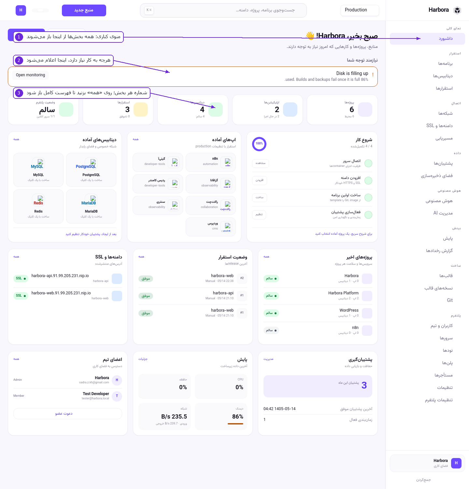
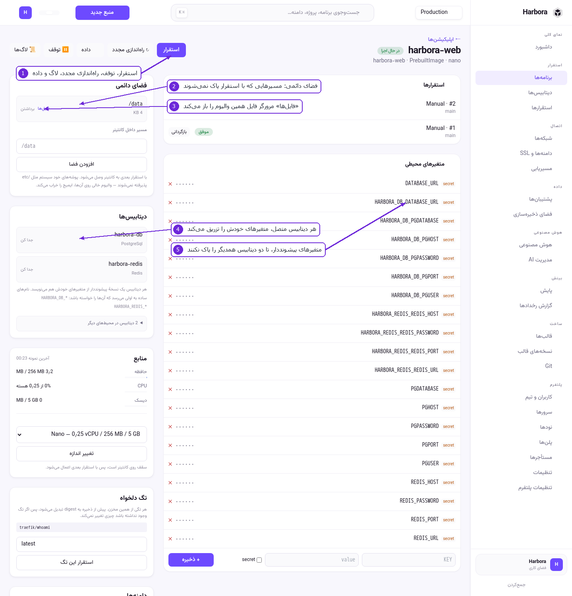
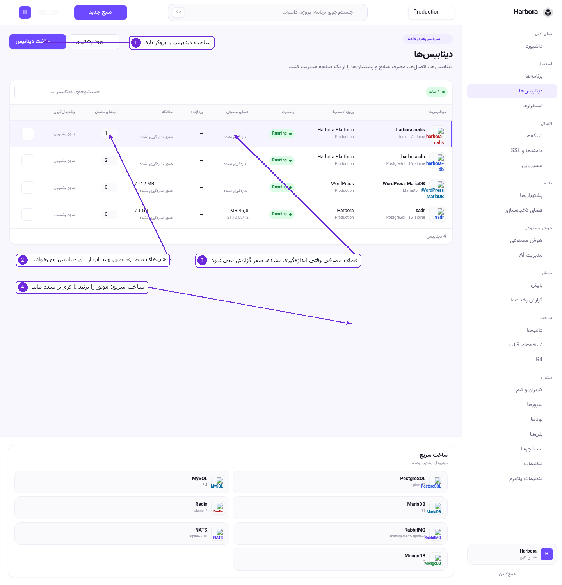
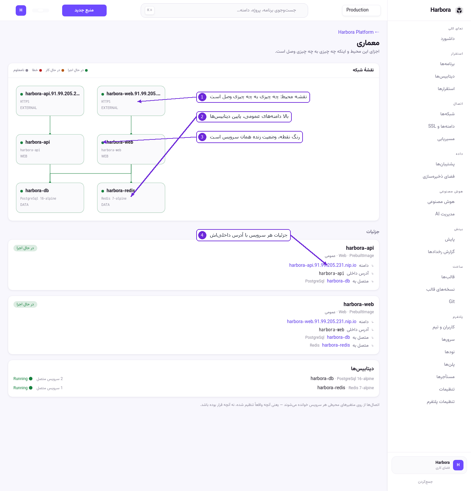
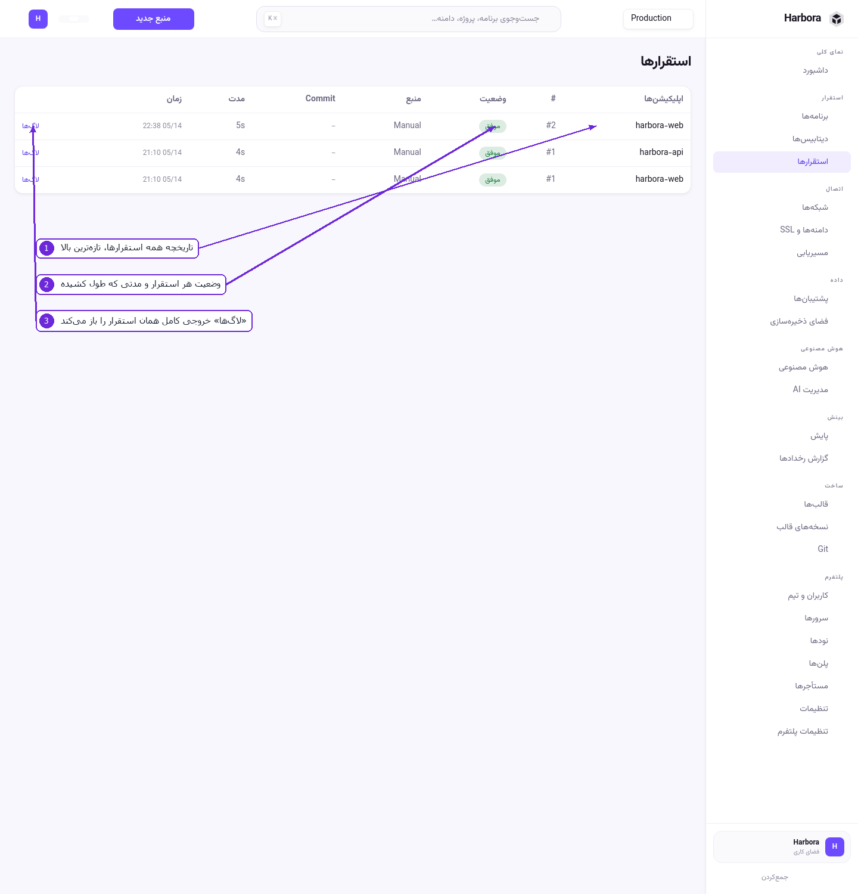
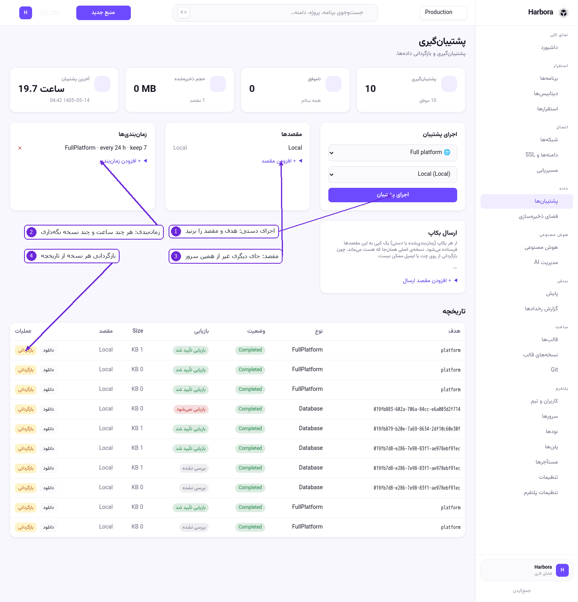

<div align="center">



<br>

[](https://github.com/sadrazkh/Harbora/releases/latest)
[](https://github.com/sadrazkh/Harbora/actions/workflows/ci.yml)
[](https://github.com/sadrazkh/Harbora/commits/master)
[](https://github.com/sadrazkh/Harbora/stargazers)

[فارسی](README.fa.md) · **English** · [📖 Tutorial](docs/tutorial) · [🧩 Functions](docs/functions.md) · [📕 Runbook](deploy/RUNBOOK.md)

### One command installs it. Everything you run lives in it. Then you can resell it.

[](#-architecture)
[](#-architecture)
[](#-architecture)
[](#-architecture)
[](README.fa.md)

</div>

## 💎 Why Harbora?

<table>
  <tr>
    <td width="50%">⚡ <b>One command, on a bare VPS</b><br>The installer brings its own prerequisites, installs Docker, asks about your domain or falls back to zero-DNS <code>nip.io</code>, writes fresh secrets, builds from source and then <b>verifies itself</b> — Traefik, the panel's route and the certificate.</td>
    <td width="50%">🏢 <b>A business, not just a dashboard</b><br>Plans, quotas, a capacity-aware scheduler, per-tenant network isolation, hourly metering and prepaid balances. Give a customer a workspace and they see only their own.</td>
  </tr>
  <tr>
    <td>🚀 <b>Deploy anything you have</b><br>A Git repo with a Dockerfile or none (buildpacks detect the stack), a Compose stack, a static site, a prebuilt image, a one-click template, or a folder pushed straight from your laptop.</td>
    <td>🧩 <b>Code with no repository at all</b><br>Write C#, JavaScript or Python in the panel. HTTP routes, cron schedules, platform events and queue messages — built, released and rolled back by the same pipeline every app uses.</td>
  </tr>
  <tr>
    <td>🔐 <b>Nodes that open no port</b><br>A worker dials the panel, so adding one needs no firewall rule, no public IP and no port-forward. Single-use enrollment, then mTLS. The panel sends named verbs from a fixed allowlist, never a shell command.</td>
    <td>🤖 <b>An assistant that asks first</b><br>Say what you want in Persian or English. It looks things up read-only, turns every change into a plan you approve, and never sees a secret you type behind the lock button.</td>
  </tr>
</table>

## 📸 A look at the panel

<table>
  <tr>
    <td width="50%"><br><b>📊 Dashboard:</b> what needs attention, and what the host is doing</td>
    <td width="50%"><br><b>📦 An app:</b> deploys, env, domains, volumes, logs, rollback</td>
  </tr>
  <tr>
    <td><br><b>🗄 Databases:</b> provisioned, credentialled and attachable in one click</td>
    <td><br><b>🕸 Architecture:</b> what talks to what, drawn from the real network</td>
  </tr>
  <tr>
    <td><br><b>🚀 Deployments:</b> live build logs, queue position, cancel, roll back</td>
    <td><br><b>💾 Backups:</b> scheduled, retained, delivered, restorable</td>
  </tr>
</table>

<sub>Screenshots are from the panel itself, annotated. The UI is bilingual — Persian and English, RTL and LTR.</sub>

## 🎯 From your code to a running app

You wrote an app. Give it to Harbora and the database, the connection, the deployment and the checks are done for you, with nothing to learn first and no AI involved.

**In the panel:** open **Launch an app** (`/launch`), give it a Git address or a zip, read the one screen that says what it found, what it will create and what that costs, and press **Launch**. It ends on the app's address, or on the exact step that stopped and what to do about it.

**From a terminal:**

```bash
cd my-app
harbora launch
```

The only thing asked of your code: read the variables you are given (`DATABASE_URL`, `REDIS_URL`, …) and listen on `0.0.0.0`. The one-page guide is **[docs/tutorial/15-launch.md](docs/tutorial/15-launch.md)**. No panel yet? Install one below.

## 🚀 Install in one command

On a fresh **Linux VPS** (Ubuntu / Debian / Fedora / Alpine), as root:

```bash
curl -fsSL https://raw.githubusercontent.com/sadrazkh/Harbora/master/deploy/install.sh | sudo bash
```

That is the whole of it. The installer is **self-contained and interactive, in Persian and English**, and it is **idempotent** — safe to re-run; an existing `.env` (your secrets) is never overwritten and a running stack is reused.

<details>
<summary><b>What it does, step by step</b></summary>

1. Checks OS and architecture compatibility.
2. **Installs every prerequisite itself** — `curl`, `git`, `openssl`, and **Docker** with Compose if missing.
3. **Asks whether you have a real domain** (deriving `panel.` and `apps.` from it) or falls back to zero-DNS `nip.io`.
4. **Tests DNS** for the panel and the apps wildcard — and warns clearly if the records do not point at this server. You can continue and fix DNS later.
5. Asks for the **Let's Encrypt email** (blank gives a sensible default).
6. Generates `/opt/harbora/app/deploy/.env` with freshly-random secrets.
7. **Builds the platform from source** and starts it: Traefik v3.6, PostgreSQL, MinIO for object storage, the panel — and a Redis container nothing uses (see [Architecture](#-architecture)).
8. **Verifies the install**: Traefik ↔ Docker API compatibility, the panel's route through Traefik (a 404 prints a clear bilingual fix), and SSL issuance (on failure it prints the ACME log lines and the likely causes).

</details>

### 🌐 Zero-DNS default — it just works

Pass no domains and Harbora uses **`nip.io`** wildcard DNS built from the server's public IP — `panel.203.0.113.10.nip.io`, for example. It resolves with **no DNS setup at all**, so you get a working HTTPS panel immediately. Ideal for trying it.

### 🏷 Custom domains, for production

Point DNS at the server first:

| Record | Points at | For |
|---|---|---|
| `panel.example.com` | your VPS IP | the panel |
| `*.apps.example.com` | your VPS IP | every app you deploy |

Then install non-interactively:

```bash
PANEL_DOMAIN=panel.example.com \
ROOT_DOMAIN=apps.example.com \
ACME_EMAIL=you@example.com \
  curl -fsSL https://raw.githubusercontent.com/sadrazkh/Harbora/master/deploy/install.sh | sudo bash
```

Run it in a terminal rather than piped and it **prompts** for these, showing the defaults.

<details>
<summary><b>🔒 How SSL works, and why no wildcard is needed</b></summary>

Traefik obtains certificates from **Let's Encrypt over the HTTP-01 challenge**: the panel domain and **each app domain get their own certificate automatically** on the first HTTPS hit, because every route Harbora generates carries `certresolver: letsencrypt`.

Two requirements: the domain's DNS must point at the server, and **port 80 must be reachable from the internet** — the challenge runs over it. A **wildcard certificate** (`*.apps.example.com`) is only possible with a DNS-01 challenge and provider API credentials; the per-subdomain design does not need one.

</details>

<details>
<summary><b>📋 Prerequisites (all installed for you)</b></summary>

Nothing to install by hand. For reference the installer ensures Docker + Compose v2, `git`, `curl` and `openssl`. Recommended VPS: **2 GB+ RAM**, x86_64 or arm64, ports **80** and **443** open.

</details>

## 🔄 Update, and 🗑 uninstall

```bash
# Update to the latest source and rebuild:
curl -fsSL https://raw.githubusercontent.com/sadrazkh/Harbora/master/deploy/install.sh | sudo bash -s -- update

# Uninstall (it asks before deleting data volumes):
curl -fsSL https://raw.githubusercontent.com/sadrazkh/Harbora/master/deploy/install.sh | sudo bash -s -- uninstall
```

From the checkout instead: `cd /opt/harbora/app/deploy && docker compose up -d --build` to update, `docker compose down` to stop, `docker compose down -v` to also wipe data.

<details>
<summary><b>↩️ An update can always be undone</b></summary>

Before an update applies any database migration, Harbora dumps the database and **refuses to migrate if that dump fails**. A schema changed with no way back is the one step of an update that cannot be reversed, so the moment the restore point can still be taken is the moment to insist on it. Nothing is dumped on a fresh install (there is nothing to lose) or on an ordinary restart (nothing changes).

```bash
harbora backups                     # list restore points; pre-upgrade-* are automatic
harbora backup-db                   # take one now, before doing something risky yourself
harbora restore-db <file>           # put the database back (asks you to type the database name)
```

`restore-db` saves the current database as `pre-restore-*` before replacing it, so restoring from the wrong file is survivable too. If a host genuinely cannot run the dump, `HARBORA_SKIP_UPGRADE_BACKUP=1` lets the update proceed without one.

Updating never overwrites `deploy/.env`, but it **does** add settings newer versions require and your file predates — most importantly `HARBORA_MASTER_KEY`. Without that backfill the panel refuses to start (it fails closed rather than leaving secrets decryptable), which looks exactly like the update breaking everything. If an update ever leaves the panel down, run **`harbora doctor`**.

</details>

## ▶️ First run

1. Open **`https://<panel-domain>/setup`** and create your **owner** account — that is you, the provider.
2. You are in. With nothing in the workspace yet the dashboard offers one thing, **Get started**, which is the launch above. After that it shows apps, deployments and host resources.

> **⏱ 60-second smoke test.** **Apps → Full form** → source *Prebuilt image* → image `nginx:alpine`, port `80`, size `nano`, domain `test.<root-domain>` → **Save** → **Deploy**. Watch the live logs, then open the domain: nginx, with a valid certificate.

A copy-paste walkthrough, including adding worker nodes, is in **[deploy/RUNBOOK.md](deploy/RUNBOOK.md)**. A screen-by-screen tour of the panel is in **[docs/tutorial](docs/tutorial)**.

## ✨ What Harbora does

<details open>
<summary><b>🚀 Deploy and build</b></summary>

- **Launch**: give it a Git address, a zip or a folder, and one screen says what it found, what it will create and what that costs. One button then creates the databases, connects them under the names your code reads, deploys, and checks what a green deployment does not prove: that the app stayed up, that each database answers on the app's network, that its address works from outside, and that its log is not complaining. Guide: **[docs/tutorial/15-launch.md](docs/tutorial/15-launch.md)**.
- **Deploy** from a Git repo (with a Dockerfile **or none** — automatic buildpacks detect Node / .NET / Go / PHP / Python / static and generate the build), a Dockerfile, a **Docker Compose stack**, a static site (Git repo served by Nginx), a prebuilt image, a CLI upload, or a one-click **template**. Templates can provision complete multi-service projects (WordPress + MariaDB, Redis Commander + Redis), private networking, generated secrets, reference variables and persistent volumes. Compose imports use the same private-network, health-check and safe cutover pipeline as ordinary apps.
- **Git integration**: connect GitHub/GitLab/Gitea by token **or OAuth**; deploy-on-push/tag through HMAC-verified webhooks; commit metadata, deploy history, rollback.
- **Visual routing designer**: drag-and-drop rules, host/path routing, SSL toggle, HTTP→HTTPS, WebSocket, basic-auth, custom headers, a live Traefik-config preview, validate and apply with rollback.

</details>

<details open>
<summary><b>🗄 Data, backups and monitoring</b></summary>

- **Managed services**: six databases — PostgreSQL, MySQL, MariaDB, Redis, MongoDB, Meilisearch — and two message brokers, **RabbitMQ** and **NATS**. All eight are provisioned the same way: encrypted credentials Harbora generates, a place on the environment's private network, safe connection info, and one-click attach that injects the connection into the app.
- **Backups**: app config, volume/database, full platform; local and S3-compatible; scheduled; retained; a copy of every backup can also be **sent to Telegram or email** (Backups → *Send backups to*) — the panel finds your Telegram chat id for you, and refuses an artifact too large for the channel instead of failing silently. Download, and restore behind a typed confirmation.
- **Monitoring and alerts**: host and container metrics, a live CPU chart, app health, disk/backup/crash warnings; notify by email, Telegram, Discord or a custom webhook.

</details>

<details open>
<summary><b>🧩 Functions — code with no repository</b></summary>

- Write code in the panel in **C#, JavaScript or Python** and it runs: no repository, no Dockerfile, no `git push`. One **function app** hosts many functions, so twenty ten-line functions cost one nano app-hour rather than twenty.
- Four ways to be triggered: an **HTTP** route, a **cron schedule**, **platform events** (a deployment finishing or failing, a crash, a failed backup, a threshold, a low balance, a git push or tag, a workspace or member change) and **queue messages** from a RabbitMQ service, with dead letters kept where you can see them.
- Publishing generates the whole build context and hands it to the ordinary deployment pipeline, so live logs, health checks, zero-downtime cutover, rollback, quotas and metering are the ones every other app already gets — and a compile error shows up in the build log at publish time. Every invocation is recorded: trigger, status, duration.
- Guide: **[docs/functions.md](docs/functions.md)**.

</details>

<details>
<summary><b>🖧 Nodes, tenancy and the rest</b></summary>

- **Node agents**: a systemd service that **opens no inbound port** — the node dials the panel, so enrolling one needs no firewall rule and works behind NAT. Single-use enrollment token, then mTLS against the panel's own CA; revoke, rotate and re-enroll from the UI. The panel sends **named verbs from a fixed allowlist**, never a shell command. Silent update with rollback, drain before update, and an uninstaller that asks whether to keep the workloads.
- **Multi-tenant PaaS**: plans, instance sizes, quotas, a capacity-aware scheduler, the provider console, per-tenant network isolation, usage metering.
- **Feature entitlements**: the owner decides who each sellable feature is for, per **plan** and per **workspace**. A workspace without it still **sees** it — greyed, with a lock, and a page saying who can switch it on — because a tier nobody can see is a tier nobody asks to buy. Every lock is enforced server-side; the greyed control is a courtesy on top of the refusal. Provider console: **Platform → Features**.
- **UI/UX**: a premium Tailwind dashboard, dark mode, RTL and LTR, PWA (installable, with an offline shell), bilingual throughout.
- **Security**: first-run setup, PBKDF2 hashing, RBAC, API and CLI tokens (hashed), AES-GCM secrets at rest, CSRF, secure cookies, webhook HMAC, an audit log, and secret redaction in logs.

</details>

## 🏢 Run it as a PaaS for customers

Harbora is multi-tenant from the ground up. As the provider you:

| Step | What you do |
|---|---|
| **1 · Plans** | Define tiers — max apps and services, CPU/RAM/disk caps, allowed instance sizes, price. *Provider* (unlimited, yours), *Starter* and *Pro* are seeded. |
| **2 · Tenants** | In the provider console create a customer **workspace**, assign a plan, and **invite a user** with an email, a temporary password and a workspace role. Suspend or resume at any time. |
| **3 · They work** | The customer signs in and sees **only their workspace**. Apps are quota-checked, the **scheduler** places them on a node with room (never overcommitting your servers), each tenant runs on its **own isolated docker network**, and usage is **metered** in GB-hours and vCPU-hours — all visible to you, per tenant. |

Customers can also register themselves. Every account receives one personal workspace and may own or join shared ones; the topbar switcher changes the active tenant boundary. Workspace admins invite people with single-use, seven-day links and manage roles **without** receiving platform-admin access. Balances belong to workspaces, so you can fund a person's private workspace or a team's independently.

> 💳 **Billable resources are prepaid.** Creating an app or a database — including templates, cloned environments and automatic previews — atomically deducts one running hour. A zero or insufficient balance, or an instance size with no configured hourly rate, leaves no resource behind. The active workspace's balance sits beside the account menu and links to its billing page.

Instance sizes (nano → large) map to real CPU and memory limits, so a customer consumes only what their plan allows.

## 🖥 The CLI

A self-contained binary — **no .NET runtime needed**.

<table>
  <tr>
    <td width="50%"><b>🐧 Linux / macOS</b><br><br><code>curl -fsSL https://raw.githubusercontent.com/sadrazkh/Harbora/master/deploy/install-cli.sh | bash</code></td>
    <td width="50%"><b>🪟 Windows — PowerShell</b><br><br><code>irm https://raw.githubusercontent.com/sadrazkh/Harbora/master/deploy/install-cli.ps1 | iex</code></td>
  </tr>
</table>

These download the right binary for your OS and architecture (x64/arm64) from the latest GitHub release and put `harbora` on your PATH.

<details>
<summary><b>Windows from cmd.exe, the .NET global tool, or building it yourself</b></summary>

```bat
:: invoke the PowerShell installer from cmd:
powershell -NoProfile -ExecutionPolicy Bypass -Command "irm https://raw.githubusercontent.com/sadrazkh/Harbora/master/deploy/install-cli.ps1 | iex"

:: …or download the exe directly (Windows 10+ ships curl):
curl -L -o "%USERPROFILE%\harbora.exe" https://github.com/sadrazkh/Harbora/releases/latest/download/harbora-win-x64.exe
```

Any OS with the .NET SDK: `dotnet tool install --global Harbora.Cli`

Not tagged yet? Build it once with `dotnet publish src/Harbora.Cli -c Release` — the output lands in `src/Harbora.Cli/bin/Release/net10.0/publish/harbora` — or run it in place with `dotnet run --project src/Harbora.Cli -- <args>`.

</details>

### Every command

```bash
harbora login                                  # asks: email + password, or an API token
harbora login --token hbr_cli_xxx --server https://panel.example.com   # non-interactive (CI)
harbora whoami                                 # which account, on which panel
harbora accounts                               # signed in to several panels? they all stay signed in
harbora update                                 # keep the CLI current; it says when it is behind the panel

harbora init                                   # writes ./harbora.yml (slug = folder name; detects a Dockerfile)
harbora doctor                                 # manifest, Dockerfile/COPY sources, $PORT, upload excludes, auth
                                               #   — deploy runs this itself before uploading

harbora launch                                 # this folder, start to finish: says what it found and what it will cost,
                                               #   then creates the app and its databases, deploys, and checks it works
harbora launch --git https://github.com/you/shop --yes   # a repository, with no questions (CI)

harbora deploy                                 # deploys this project from ./harbora.yml, following live logs
harbora deploy my-app --ref main               # …or without a config file
harbora deploy my-app --tag v1.0.0             # deploy a specific tag
harbora apps                                   # what this panel is running
harbora logs <deploymentId>                    # follow one deployment
harbora cancel <deploymentId>                  # stop one that is queued or running
harbora status                                 # where things stand

harbora env pull                               # the app's effective environment (vars + groups + attached
                                               #   services, secrets decrypted and marked) → .env.local
harbora run -- npm start                       # run a local command with that same environment injected
```

`harbora init` makes `harbora.yml` ready to edit, so `harbora deploy` needs no arguments and the same file drives CI. Use a different name with `harbora init --app my-name`.

`harbora env pull` never overwrites an existing `.env.local` silently — it shows which keys would change and needs `--force`. `.env.local` is already excluded from every upload, and `harbora doctor` warns when it exists but `.gitignore` does not exclude it, since it can hold real secret values.

### 📤 Push code straight from your machine, with no Git

For a project that is not in a repository the server can reach — a private machine, a work laptop, a folder you have never pushed anywhere:

```bash
# 1. In the panel: Apps → Full form → source "Harbora CLI" → Save
# 2. Once, on your machine. Your panel account is enough; no token to create first:
harbora login --email you@example.com --server https://panel.example.com

# 3. From the project folder:
harbora deploy            # asks which app, then remembers it in harbora.yml
```

The folder is packed, uploaded and built **on the server** — the same build path a Git deploy takes, so stack detection, zero-downtime cutover and rollback behave identically. `harbora deploy` pushes automatically when the folder has no `.git`.

No app for it yet? `harbora launch` from the same folder does step 1 for you and makes its databases too: **[docs/tutorial/15-launch.md](docs/tutorial/15-launch.md)**.

| Flag | Effect |
|---|---|
| `--push` | Always upload this folder, even inside a Git repo |
| `--path <dir>` | Push a different folder than the current one |
| `--ref <branch>` / `--tag <v1.0>` | Deploy from Git instead — never uploads |
| `--yes` | Do not ask which app; use the one in `harbora.yml` (implied in CI) |

> **What never leaves your machine.** `.dockerignore` is honoured first — it is what the build actually reads — then `.gitignore`. On top of that these are always skipped, even with no ignore file:
> `.git` · `node_modules` · `vendor` · `bin` · `obj` · `dist` · `build` · `.next` · `.venv` · `__pycache__` · `.idea` · `.vs` · `.vscode` · **`.env`** · `.env.local`
>
> `.env` is excluded deliberately: it usually holds local database URLs and API keys. Production values belong in the app's **Environment Variables**, not in an uploaded file.

## 🖧 Add nodes — one panel, many servers

### Node Agent v1 — the one to use

A lightweight systemd service on the node that **opens no inbound port**: the node dials the panel, so adding one needs no firewall rule, no public IP and no port-forward. It works behind NAT.

In the panel: **Nodes → Add a node** → copy the command. On the node, as root:

```bash
curl -fsSL https://raw.githubusercontent.com/sadrazkh/Harbora/master/deploy/node-agent/install.sh \
  | bash -s -- --control-plane https://panel.example.com --token hbr_enroll_xxx --name web-01
```

The token is **single-use and short-lived**. The node registers, gets a permanent id and its own certificate, and the token is never used again — the ongoing link is **mTLS** against a CA the panel owns. Revoke, re-enroll and rotate are each one click.

Once enrolled the node becomes a scheduling target automatically: new apps land wherever there is room. Add `--region`, `--environment` or `--labels k=v` as placement hints.

> 🔒 The panel can never run a shell command on a node. It sends **named verbs from a fixed allowlist** — deploy a workload, read a status, snapshot a volume — each with a schema, a permission check and an audit entry. There is deliberately no "run this command" verb.

Full guide: **[docs/node-agent/installation.md](docs/node-agent/installation.md)** · security model: **[docs/node-agent/security.md](docs/node-agent/security.md)**

<details>
<summary><b>🏠 A node behind NAT</b></summary>

A node on a home connection or a private network has no reachable address, so the panel's proxy cannot open a socket to it and every route would time out — deploys succeed and the site is dead.

Open the node in **Nodes** and press **Serve through the ingress tunnel**. The node opens a second outbound connection and the panel routes customer traffic back down it. Nothing about the app changes: same domain, same certificate, same routing rules.

The tunnel reaches **only ports the node itself published for a deployed workload**, and it names a port rather than an address, so it cannot be turned into a port-forward into the customer's private network. Deleting a workload withdraws its port with no separate step to forget.

</details>

<details>
<summary><b>⚠️ The older HTTP agent — deprecated</b></summary>

> **Deprecated as of v0.2.0. Do not use it for a new node** — use Node Agent v1 above. It keeps working and stays supported for **at least two more minor versions**; no end-of-life date is set, and one will be announced here before it takes effect. Nothing is being taken away from a fleet that already runs it.

It listens on a port and the panel connects **in**, so it needs an inbound firewall rule and a publicly reachable address. Two things it cannot do, which Node Agent v1 can:

- **It has no automated tests.** `src/Harbora.Agent` is one file and no test project references it. That is why it is frozen rather than developed further.
- **A server behind it cannot back up its own volumes or databases.** The helper container would stage the archive on *its* host while the panel reads its own, so the panel refuses in front of the work instead of writing an archive nobody can collect. See [docs/disaster-recovery.md](docs/disaster-recovery.md).

For a node that already runs it, the install was:

```bash
git clone https://github.com/sadrazkh/Harbora /opt/harbora/app && cd /opt/harbora/app/deploy
docker build -f Dockerfile.agent -t harbora/agent:latest ..
export HARBORA_AGENT_TOKEN=$(openssl rand -hex 24); echo "$HARBORA_AGENT_TOKEN"
docker compose -f agent.compose.yml up -d
```

and the panel connects at **Servers → Add a server** → `http://<worker-ip>:9700` with that token, optionally over mTLS. Moving a node to Node Agent v1 means enrolling it and redeploying its apps; there is no in-place conversion.

</details>

## 🆘 `harbora` on the server — administration and recovery

The installer puts a **`harbora`** command on the server at `/usr/local/bin/harbora`. It exists for the moment you **cannot get into the panel**: it says what the platform is configured with, explains what is wrong, and can reset the admin password.

The recovery commands deliberately **do not need a healthy panel** — they run the app as a one-off container that never starts the web server, so they work while the panel is crash-looping.

```bash
harbora doctor      # ← start here: config, containers, ports, and the panel's last errors
```

<details open>
<summary><b>🔍 Diagnose</b></summary>

| Command | What it does |
|---|---|
| `harbora doctor` | Checks the master key, domains, DB password, container states and ports 80/443. Prints the panel's recent log lines when it is not running, and names the fix for each problem found |
| `harbora status` | Container status (`docker compose ps`) |
| `harbora logs [panel\|traefik\|postgres]` | Follow logs; defaults to `panel` |
| `harbora info` | Configuration as the **app** sees it: master-key state, domains, database reachability, pending migrations, user and workspace counts, and the owner's email |
| `harbora env` | Everything in `deploy/.env`. Secrets show as `(set, hidden)` — safe to paste into an issue |

</details>

<details>
<summary><b>🔑 Get back in</b></summary>

| Command | What it does |
|---|---|
| `harbora users` | List accounts, roles, and whether they are active |
| `harbora reset-password` | Reset the **owner's** password (prompts for the new one) |
| `harbora reset-password --email you@example.com --password 'new-pass'` | The non-interactive form |
| `harbora make-owner --email you@example.com` | Promote an account to Owner — for when the only owner was deleted or demoted |
| `harbora unlock --email you@example.com` | Re-enable a deactivated account without changing its password |

Passwords must be at least 8 characters. A reset also re-activates the account, because a locked-out admin usually needs both.

</details>

<details>
<summary><b>⚙️ Change settings</b></summary>

| Command | What it does |
|---|---|
| `harbora set-domain <panel-domain> <apps-domain>` | Change both domains and restart. Point DNS at the server first |
| `harbora fix-key` | Generate a `HARBORA_MASTER_KEY` when it is missing or still the insecure development default, then restart |
| `harbora restart` / `harbora stop` | Lifecycle |
| `harbora backups` / `harbora backup-db` / `harbora restore-db <file>` | Database restore points |

> ⚠️ `harbora fix-key` **replaces** an existing key only if you type `REPLACE` when prompted. Replacing a working key makes every stored secret — env vars, git tokens, agent tokens — permanently unreadable. It is meant for the case where no usable key exists at all.

Installed somewhere other than `/opt/harbora`? Set `HARBORA_DIR=/your/path harbora doctor`.

</details>

> **Two tools share the name `harbora`.** On a server it is this admin and recovery command, installed by `install.sh`; on a developer machine it is the deploy CLI, installed by `install-cli.sh`. Running the CLI installer *on a server* would overwrite the recovery command, so it detects that case and installs itself as **`harbora-cli`** instead, leaving `harbora doctor` intact.

## 🏛 Architecture

A clean, modular .NET solution (`Harbora.slnx`):

```
Domain → Application (ports) → Infrastructure / Data → Web
                                    + NodeAgent (+ Contracts) · Agent · Cli · Shared
```

| Piece | What it is, and why |
|---|---|
| **Reverse proxy** | **Traefik** — hot-reloads dynamic config with no restart, built-in Let's Encrypt, discovers containers by label. The visual designer emits routes; Harbora renders, validates and applies the Traefik config |
| **CSS** | **Tailwind** — an original, premium look rather than a stock admin template, with first-class dark mode and RTL/LTR |
| **Frontend** | **Vue islands via Vite**, compiled into `wwwroot/build`; Razor hydrates only the interactive nodes. **No separate SPA server** |
| **Containers** | **Docker.DotNet** behind one `IDockerEngine` seam — local in-process, a v1 node over its own channel, or the older agent over HTTP. No shell-string commands |
| **Nodes** | **A versioned contract**, not an API surface that drifted. `contracts/node-agent/v1/` holds the JSON schema, the framing and the compatibility rules; the C# mirror is checked against it by conformance tests, so the two ends cannot disagree silently |
| **Live logs** | **SignalR** |
| **Database** | **PostgreSQL + EF Core** |

**Jobs: a durable queue in PostgreSQL.** Enqueuing is a row in the `Jobs` table; an in-process worker pool claims rows from it, so a job survives a restart of the panel and a build that was running when the process died is picked up again rather than lost. Concurrency is `Jobs:MaxConcurrency`, defaulting to `min(4, ProcessorCount)`; setting it to `1` restores the single-worker behaviour older installs had.

> **There is no Redis in that path.** The compose stack still starts a `redis` container and `Harbora.Infrastructure` still carries the `StackExchange.Redis` package, and today nothing in the product opens a connection to either. Redis appears in Harbora only as a database you can offer a customer.

## 🛠 Local development

Prerequisites: **.NET 10 SDK**, **Node 22**, **PostgreSQL** (Docker is easiest).

```bash
docker run -d --name harbora-pg -e POSTGRES_USER=harbora -e POSTGRES_PASSWORD=harbora \
  -e POSTGRES_DB=harbora -p 5432:5432 postgres:16-alpine

cd src/Harbora.Web && npm install && npm run build && cd ../..   # the Vue islands + Tailwind
dotnet run --project src/Harbora.Web                             # auto-migrates + seeds → /setup
```

## 🔧 Troubleshooting

**Start with `harbora doctor`** — it checks everything in the table below and names the fix.

| Symptom | Cause | Fix |
|---|---|---|
| **Nothing comes up after an update** — the panel container restarts in a loop | `deploy/.env` was written by an older installer and has no `HARBORA_MASTER_KEY`. The panel now *refuses to start* without one rather than leave every stored secret trivially decryptable | `harbora doctor` names it; `harbora fix-key` generates one and restarts. The installer's `update` now backfills it automatically |
| **Cannot sign in** / password forgotten / owner account lost | — | `harbora reset-password` for the owner, or `harbora make-owner --email you@example.com`. Both work while the panel is down |
| **Wrong domain** after moving servers or changing DNS | `PANEL_DOMAIN` / `ROOT_DOMAIN` still point at the old name | `harbora set-domain panel.example.com apps.example.com` |
| Not sure what is configured | — | `harbora info` (as the app sees it) or `harbora env` (raw, secrets hidden) |
| The panel returns **404** (Traefik's default page) | Traefik did not read the panel container's labels — usually the Docker-API error below, or Traefik started before the panel | `docker compose logs traefik \| tail -50`, then `docker compose restart traefik` |
| Traefik log: **`client version 1.24 is too old. Minimum supported API version is 1.40`** | An old Traefik (≤ v3.2) with a new Docker Engine (27+/29) | This repo pins **traefik:v3.6**, which is compatible: `docker compose pull traefik && docker compose up -d traefik` |
| **No SSL certificate** / the browser warning persists | DNS does not point at the server, or port **80** is unreachable — the HTTP-01 challenge needs it | `getent hosts panel.your-domain` must return the server IP. Open port 80. ACME log: `docker logs harbora-traefik 2>&1 \| grep -i acme \| tail -20` |
| **DNS wrong** — the installer warned during setup | A or wildcard records missing, or pointing elsewhere | Add `A panel.example.com → server IP` and `A *.apps.example.com → server IP`, wait for propagation, re-run the installer with `update` |
| **Ports 80/443 already in use** | Another web server (nginx/apache) on the host | `systemctl stop nginx && systemctl disable nginx` (or apache2), then `docker compose up -d` |
| **ARM64 server** | — | Fully supported: the installer detects `aarch64`/`arm64`, and the Traefik, Postgres, Redis and .NET images are all multi-arch. The first build is just slower |
| The panel container **exits on boot** | The database is not ready, or `.env` is wrong | `docker compose logs panel` — it retries the database; check the `POSTGRES_*` values in `.env` |
| You want a clean re-install | — | `docker compose down -v` (**destroys data**), delete `deploy/.env`, re-run the installer |

## ⚠️ Known limitations

Written down because a platform that hides these is a platform you find them in later.

- Multi-server routes cross nodes through published host ports — there is no shared overlay — so an app and the managed services it attaches to should live on the same node. On a NAT'd node the panel's ingress tunnel carries that traffic instead, which puts the panel on the path of every request to that node: fine for an ordinary web app, worth measuring before a busy one goes behind it.
- A v1 node runs prebuilt images. Building from source happens on the panel; the node is told a digest to pull, never a repository to clone.
- **Only the panel's own host can back up volumes and databases.** A volume or managed database on any other server — a v1 node or a legacy agent — cannot be backed up or restored yet: carrying an archive between two machines needs a transport Harbora does not have. It refuses before it starts rather than writing an archive nobody can read back. Plan for it in [docs/disaster-recovery.md](docs/disaster-recovery.md).
- **All three function hosts build and run; what is still unwritten is `docker build` on a server.** The generator's own output — the real `FunctionProject` source, copied byte for byte rather than retyped — was built and exercised in a scratch harness on 2026-08-18: each runtime answered `/__harbora/health` with its own name and the right function count, routed requests, refused an unsigned invocation with 401, accepted a signed one with 204, and logged a scheduled run. The one step nothing in this repository records is the first `docker build` of those Dockerfiles through the deploy pipeline on a real server. Written up in [the functions design](docs/superpowers/specs/2026-08-18-functions-design.md) §3.
- **Launch is tested in pieces, not yet end to end on a real server.** The reading of a source tree runs against real files, but creating, deploying and checking are tested against fakes for Docker, Traefik, certificates and the database engines, so no record here shows a launch going from a real repository to a real address. Three limits are by design: the database check proves the database answers on the app's network with its own credentials, not that your code connected; a 404 at the address counts as something answering; and MongoDB, RabbitMQ and NATS are not connection-tested at all, and say so rather than passing.
- **Functions do not scale to zero and are not billed per request.** The host runs like any other app and is metered by the hour — the answer this platform already settled on for a self-hosted, single-VPS product. Nor do they install packages: each host has what its base image ships, and a function that needs npm or NuGet is an ordinary application.
- **The AI service is a preview.** Everything around it is built and tested — plans, keys, routing, rate limits, metering, SSRF checks — but no request has ever been made to a real model provider from this codebase, so nothing has proven the last hop. It is labelled *Preview* in the panel and hidden from the sidebar in Simple mode until one has.
- **The in-panel assistant is new, and most of it has not met a real model yet.** It is a chat drawer opened from the top bar (`Ctrl+J`) that answers in Persian or English, writes its answer as it is generated (and keeps it if you reload mid-answer), looks things up with read-only tools, and turns every change — apps, databases, projects, environment variables, domains, deploys, rollbacks, deletes — into a plan you approve: safe changes ask once and can be remembered, dangerous ones always ask, and a delete asks you to type the resource's name. Secrets go in through a lock button, so the model only ever sees a placeholder and the panel puts the value in when the step runs. It has the signed-in person's permissions and no more, and its model calls are counted per workspace per day. It stays off until the owner gives **Settings** an OpenAI-compatible provider (OpenRouter works) and the `assistant` feature is enabled under **Platform → Features** (the provider's own default plan has it). Everything is tested against scripted fakes. The first, read-only release has been run against a real free model on OpenRouter — the **Test the agent model** button passed 6 of 6 — but the write tools, the streamed answers and the lock button have not yet been run against a real provider, so which free models call tools well, in Persian especially, is still unproven. Guide: [docs/tutorial/08-ai.md](docs/tutorial/08-ai.md).
- Git OAuth requires registering an OAuth app for a client id and secret; connecting by token needs no setup.
- Billing includes balances, manual operator credit and adjustment, single-use vouchers, hourly pay-as-you-go ledger lines and per-resource statements. There is deliberately no online payment gateway.
- Workspace governance includes seat reservations for pending invitations, per-workspace roles, project and environment grants, ownership transfer, self-service leave, and plan limits for projects, environments, domains, persistent volumes and recurring backup schedules.
- Health checks HTTP-probe the app's health path, falling back to container liveness when none is set.

## 🙏 Built with

[.NET 10](https://dotnet.microsoft.com) · [Traefik](https://traefik.io) · [PostgreSQL](https://www.postgresql.org) · [Docker](https://www.docker.com) · [Vue](https://vuejs.org) · [Vite](https://vitejs.dev) · [Tailwind CSS](https://tailwindcss.com) · [SignalR](https://dotnet.microsoft.com/apps/aspnet/signalr) · [MinIO](https://min.io) · [Lucide](https://lucide.dev)

License: TBD.

<div align="center">

<br>

**If Harbora is useful to you, a ⭐ helps other people find it.**

[🐞 Report a problem](https://github.com/sadrazkh/Harbora/issues) · [📕 Runbook](deploy/RUNBOOK.md) · [📖 Tutorial](docs/tutorial) · [فارسی](README.fa.md)

</div>
