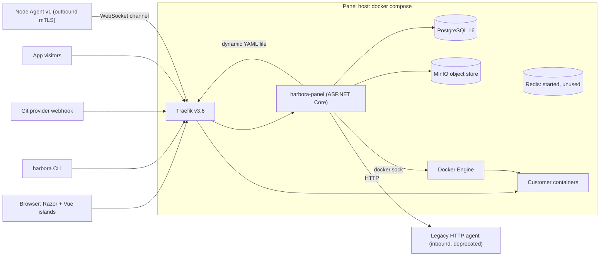
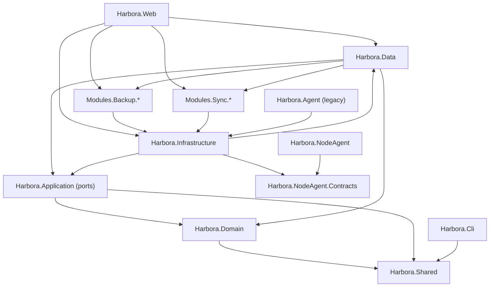
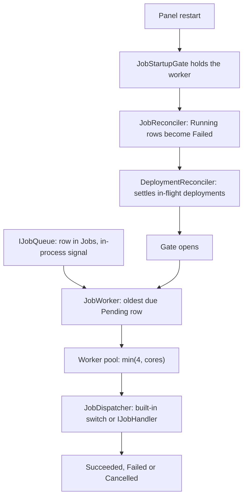
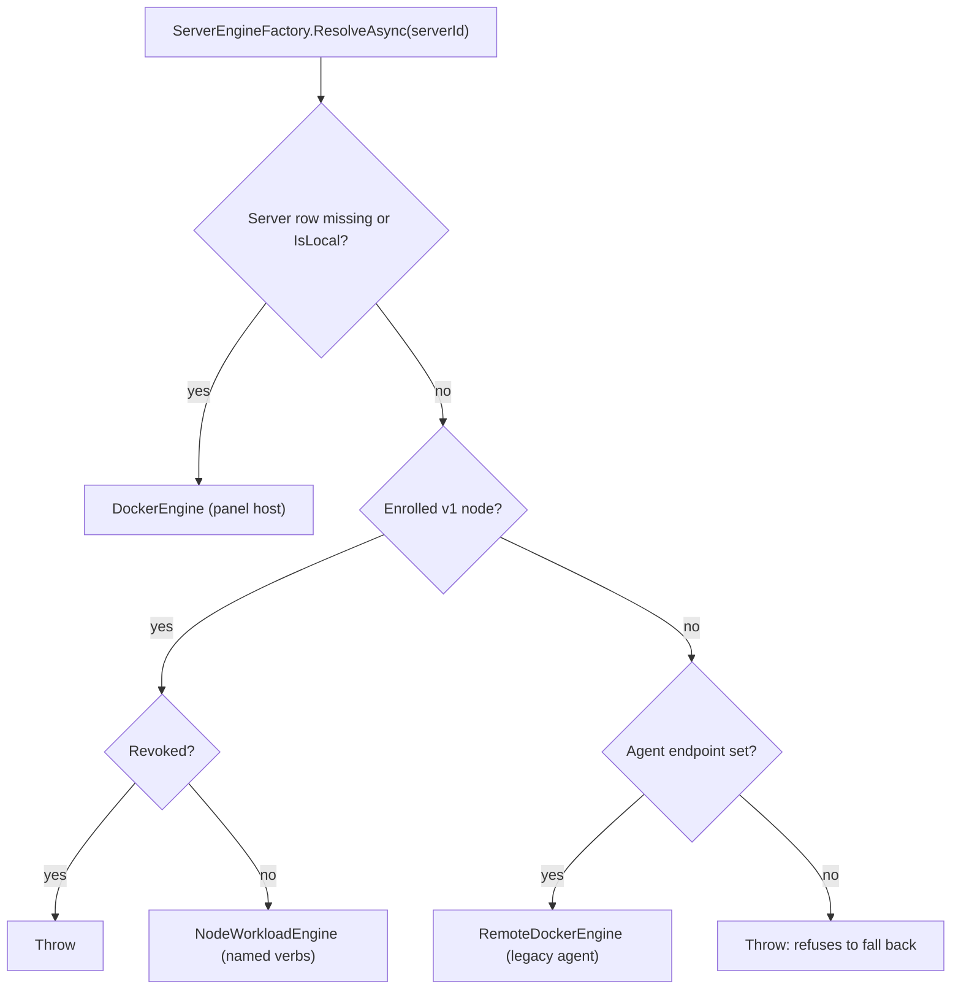
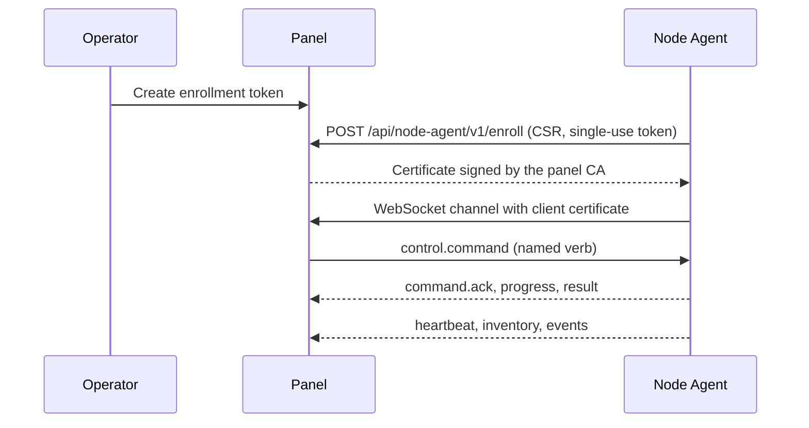
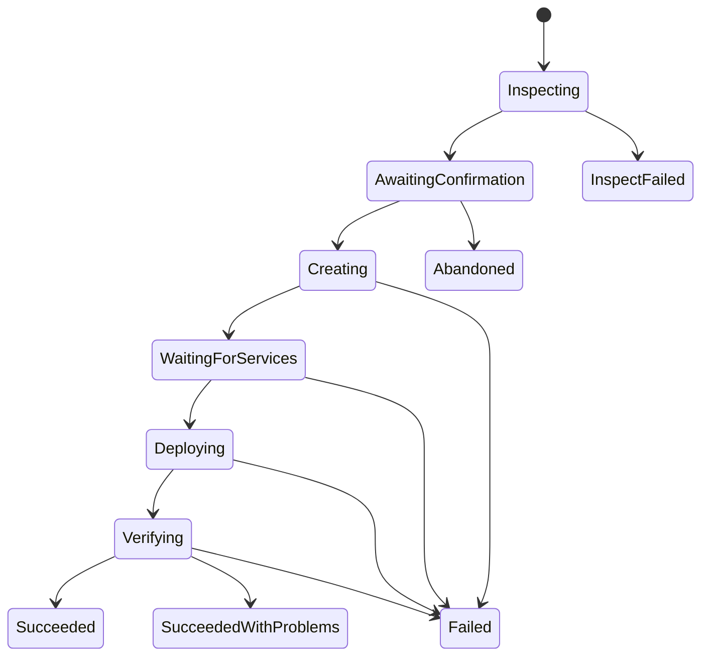

Last verified: 2026-11-08
Scope: solution structure, `Program.cs`, `DependencyInjection.cs`, deploy pipeline, job queue, launch, proxy, node channel and tenancy at commit `b3fd974`, read statically. Nothing was run. Short paths such as `Deployments/DeploymentPipeline.cs` are under `src/Harbora.Infrastructure/`. Updated 2026-11-12 for round nine, released as 0.13.0; nothing else was re-verified.

# Architecture

Labels: [Verified], [Assumption], [Recommendation]; see [MASTER_CONTEXT.md](MASTER_CONTEXT.md). Every diagram here is **[Verified]** against the files named beneath it.

## System context



Sources: `deploy/docker-compose.yml`, `src/Harbora.Infrastructure/Proxy/TraefikProxyEngine.cs`, `src/Harbora.Web/Infrastructure/NodeChannelEndpoint.cs`.

- [Verified] Redis is started by the compose stack and `StackExchange.Redis` is referenced by `Harbora.Infrastructure.csproj`, but no source file uses it. Redis exists in the product only as a database customers can order.
- [Verified] The panel mounts the Docker socket, so it has root-equivalent control of its own host (`deploy/docker-compose.yml`, panel `volumes`).

## Project dependencies



Source: the `ProjectReference` items of each `.csproj`.

- [Verified] `Harbora.Cli` and `Harbora.NodeAgent` do not reference the panel. They share only `Harbora.Shared` and `Harbora.NodeAgent.Contracts` respectively.
- [Verified] `Harbora.Data` references only the `Domain` projects of the two modules, so it can map their tables without depending on their behaviour.
- [Verified] `Harbora.Web` calls concrete `Harbora.Infrastructure` types directly, in controllers and views. The layering is a convention, not a compile-time boundary, and differs from what ADR-001 hoped for (KI-050).

## Request pipeline

```mermaid
flowchart LR
    A["Security headers"] --> B["Forwarded headers"]
    B --> C["Status page host rewrite"]
    C --> D["Localization"]
    D --> E["Maintenance mode"]
    E --> F["Static files, WebSockets"]
    F --> G["Routing, rate limits"]
    G --> H["Authentication"]
    H --> I["Workspace membership check"]
    I --> J["Authorization"]
    J --> K["Setup guard"]
    K --> L["Controllers, SignalR hub, node channel"]
```



Source: `src/Harbora.Web/Program.cs:230-293`.

- [Verified] At boot the panel takes a restore point, migrates, seeds, and exits non-zero on failure (`Program.cs:192-228`).
- [Verified] `/healthz` is the unauthenticated liveness probe used by the container health check.

## Tenancy

- [Verified] A workspace is the tenant boundary. 66 entities carry a global query filter of the form `IgnoreWorkspaceFilter || x.WorkspaceId == CurrentWorkspaceId` (`src/Harbora.Data/HarboraDbContext.cs`).
- [Verified] In a request, `HttpWorkspaceScope` reads the `workspace` claim; no claim means `Guid.Empty`, which matches nothing. With no `HttpContext` the scope is unscoped (`src/Harbora.Web/Infrastructure/HttpWorkspaceScope.cs:19-24`).
- [Verified] `WorkspaceMembershipValidationMiddleware` runs between authentication and authorization and rechecks session, membership and workspace on every request (`Program.cs:280-282`).
- [Verified] Tables with no `WorkspaceId` (for example `Volumes`) have no filter, so controllers must scope them by hand through their parent.
- [Verified] Background services run with no `HttpContext`; most also call `IgnoreQueryFilters()` explicitly.
- [Verified] Apps and managed services join a private Docker network per environment (`src/Harbora.Infrastructure/Networking/EnvironmentNetwork.cs`).

## Deployment flow

```mermaid
sequenceDiagram
    participant U as User, CLI or webhook
    participant E as DeploymentEngine
    participant Q as Jobs table
    participant W as JobWorker
    participant P as DeploymentPipeline
    participant D as IDockerEngine
    participant T as TraefikProxyEngine

    U->>E: QueueDeploymentAsync
    Note over E: One unsettled deployment per app; a second request coalesces onto it
    E->>Q: Insert Job, signal worker
    W->>Q: Claim oldest due job
    W->>P: ExecuteAsync
    P->>P: Snapshot config, billing gate
    P->>D: Build or pull image
    P->>D: Networks and volumes
    P->>P: Wait for databases being set up, bounded
    P->>D: Release task, then start new replicas beside old
    P->>P: Health check, all replicas or none
    P->>T: Write routes, atomic swap
    P->>D: Retire old containers
    P->>P: Mark Succeeded
```

Source: `src/Harbora.Infrastructure/Deployments/DeploymentEngine.cs`, `DeploymentPipeline.cs:61` onward.

- [Verified] On failure only the new replicas are removed; the previous release keeps serving (`DeploymentPipeline.cs:753` onward).
- [Verified] Compose and cron apps take shorter paths that leave the single-container path early and skip part of its cleanup (KI-012, KI-013).

## Job queue and restart



Source: `src/Harbora.Infrastructure/Jobs/`, `DependencyInjection.cs:129-169`, `Deployments/DeploymentReconciler.cs`.

- [Verified] One claim at a time per `(Kind, ExclusiveWith ?? TargetId)` inside this process. `ClaimStamp` is the concurrency token. There is no fairness between tenants, and multiple panel instances are not supported.
- [Verified] Graceful shutdown returns running jobs to `Pending`; a hard stop fails them on the next boot.

## Docker engine selection



Source: `src/Harbora.Infrastructure/Docker/ServerEngineFactory.cs:36-79`.

- [Verified] A v1 node has no build, exec or one-off verb by design (`Nodes/NodeWorkloadEngine.cs:179,621`). Images are built on the panel and the node is told a digest.

## Routing

- [Verified] Route rows are the single source. `RouteCatalog` reads all enabled rows, `TraefikProxyEngine` renders one YAML file, and writes it through validation, a temporary file, a `.bak` copy and an atomic move, restoring on failure (`Proxy/TraefikProxyEngine.cs:174`).
- [Verified] `ProxyBootRepublisher` re-applies the file at boot.
- [Verified] Certificates are issued by Traefik through ACME. The resolver is `letsencrypt`, or `cloudflare` when a marker file exists. The panel only observes certificates (`Monitoring/CertificateWatcher.cs`).

## Nodes



Source: `src/Harbora.Infrastructure/Nodes/NodeEnrollmentService.cs`, `src/Harbora.Web/Infrastructure/NodeChannelEndpoint.cs`, `src/Harbora.NodeAgent.Contracts/NodeCommands.cs`.

- [Verified] The verb list is closed: 25 verbs in `NodeCommandCatalog`, mirrored in `contracts/node-agent/v1/node-agent.v1.schema.json`. There is no shell verb.
- [Verified] A command is persisted before sending, and a disconnected node fails it immediately; there is no offline queue (`NodeCommandService.SendAsync`).
- [Verified] A node behind NAT can use the ingress tunnel, which dials only ports the node itself published (`docs/product-audit/19-do-not-change-list.md` item 11, `NodeTunnelGateway`, `TunnelSupervisor`).

## Launch



Source: `src/Harbora.Domain/Launch/AppLaunch.cs:21-59`, `src/Harbora.Infrastructure/Launch/LaunchAdvance.cs`.

- [Verified] A failed launch can be retried (`RetryAsync`), and an unconfirmed one times out after 24 hours.
- [Verified] Only inspection is a durable job (`JobKind.LaunchInspect`). Later states are moved by `LaunchTicker`, a session-less service on a 3-second tick after a 25-second start delay.
- [Verified] No model or AI provider is called anywhere in this path (`docs/superpowers/specs/2026-11-04-launch-design.md`, `src/Harbora.Infrastructure/Launch`).

## Background services

[Verified] Registered with `AddHostedService` across `DependencyInjection.cs` and the module extensions:

| Area | Services |
|---|---|
| Jobs and startup | `JobWorker`, `JobStartupGateOpener`, `JobReconciler`, `DeploymentReconciler`, `AgentPlanStartupReconciler`, `BackupModuleReconciler` |
| Deploy and routing | `CronRunner`, `DeploymentApprovalExpirySweeper`, `PanelNetworkRebinder`, `ProxyBootRepublisher`, `PreviewSweeper`, `LaunchTicker` |
| Billing and metering | `BillingScheduler`, `MeteringService`, `StorageMeasurer`, `BucketMeasurementSweeper` |
| Nodes | `NodeHeartbeatMonitor`, `NodeIngressRebinder`, `NodeTunnelGateway`; on the agent side `NodeAgentWorker`, `MetricsEndpoint` |
| Backups | `BackupScheduler`, `BackupVerifier`, `WalArchiveShipper`, `ReplicationLagMonitor`, `BackupPolicyScheduler` |
| Observability | `LogIngestionHostedService`, `MetricsCollectorHostedService`, `UptimeChecker`, `CertificateWatcher`, `NotificationDigestScheduler` |
| Functions | `FunctionCronScheduler`, `QueueFunctionConsumerHost` |
| Maintenance | `DataRetentionSweeper`, `DanglingImageSweeper`, `BuildDirectorySweeper` and `StrandedProvisionReconciler` (both since 0.13.0), `AgentConversationRetentionSweeper`, `UpdateCheckService`, `GrantSweeper`, `LedgerSweeper`, `DatabaseAccessSweeper`, `DatabaseMaintenanceScheduler`, `AdminerSweeper`, `VolumeDownloadTokenSweeper`, `SyncStatusRefresher` |

## Front end

- [Verified] Razor renders every page. Six Vue islands mount by id or `[data-island]`: `deployment-logs`, `route-designer`, `assistant-panel`, `app-terminal`, `function-code-editor`, `metrics-chart` (`src/Harbora.Web/Scripts/main.ts:16-114`). Three are lazily imported.
- [Verified] Vite builds into `wwwroot/build`. `ViteManifest` resolves hashed names at runtime.
- [Verified] The default culture is Persian with English as the alternative; the cookie decides first (`Program.cs:99-107`). Most copy is written inline as `isFa ? … : …` (2,831 occurrences); `SharedResource.fa.resx` has 244 entries.
