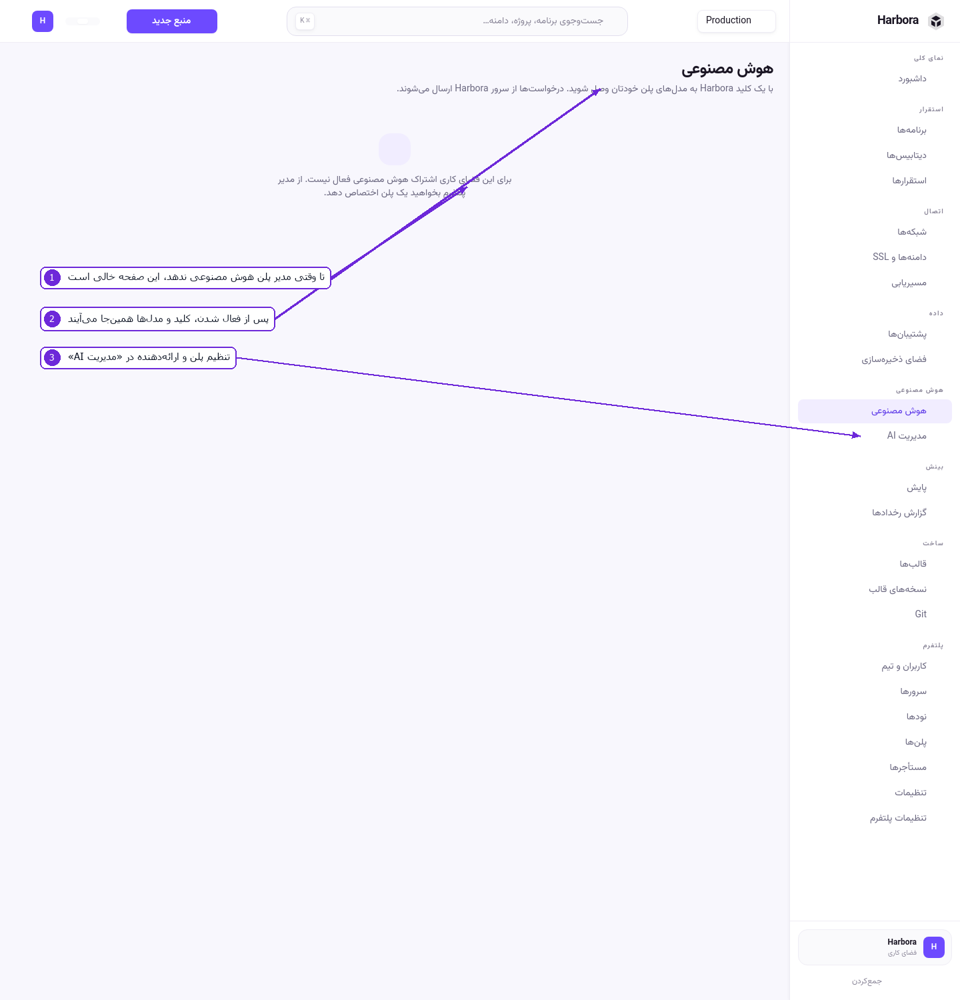
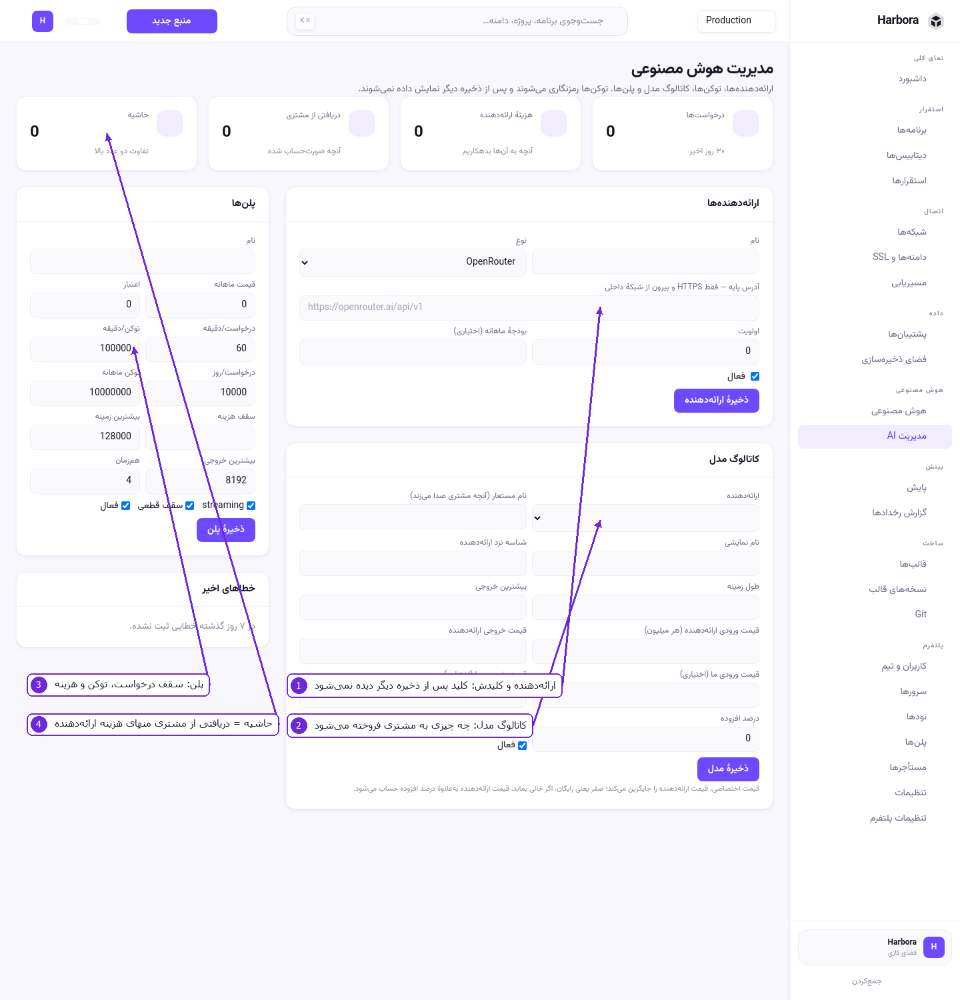

# ۸ — هوش مصنوعی

Harbora یک دروازهٔ AI دارد: مدل‌ها را از یک یا چند ارائه‌دهنده می‌گیرد، پشت یک کلید و یک API سازگار
با OpenAI به فضاهای کاری می‌فروشد، و مصرف را می‌شمارد.

دو صفحه دارد و ترتیبشان مهم است: اول **مدیریت AI** (کار مدیر)، بعد **هوش مصنوعی** (کار کاربر).

جدا از این دو صفحه، یک **دستیار هوشمند** هم هست که کنار همهٔ صفحه‌ها باز می‌شود؛ توضیحش در پایین همین بخش آمده است.

## صفحهٔ کاربر



۱. تا وقتی مدیر به این فضای کاری پلن هوش مصنوعی نداده باشد، صفحه همین را می‌گوید و کار دیگری
   نمی‌کند. این حالت درست است، نه خطا.
۲. پس از فعال‌شدن، کلید و فهرست مدل‌های همان پلن اینجا می‌آید.
۳. تنظیمش در **مدیریت AI** است.

پس از فعال‌شدن، درخواست‌ها از سرور Harbora ارسال می‌شوند — یعنی کلید ارائه‌دهنده هیچ‌وقت به دست
کاربر نمی‌رسد و مصرف قابل شمردن است. مسیرش سازگار با OpenAI است:

```bash
curl https://panel.example.com/v1/chat/completions \
  -H "Authorization: Bearer <کلید فضای کاری>" \
  -H "Content-Type: application/json" \
  -d '{"model":"<نام مستعار مدل>","messages":[{"role":"user","content":"سلام"}]}'
```

مسیرهای موجود: `GET /v1/models`، `POST /v1/chat/completions`، `POST /v1/responses`،
`POST /v1/embeddings`.

## مدیریت AI



۱. **ارائه‌دهندگان** — نوع (OpenRouter یا سازگار با OpenAI)، آدرس پایه و کلید.
   کلید رمزنگاری‌شده ذخیره می‌شود و **پس از ذخیره دیگر نمایش داده نمی‌شود**. اولویت و بودجهٔ ماهانه
   هم همین‌جا تعیین می‌شود.
۲. **کاتالوگ مدل** — کدام مدل از کدام ارائه‌دهنده، با چه **نام مستعاری** به مشتری فروخته می‌شود.
   قیمت ورودی/خروجی ارائه‌دهنده و قیمت خودتان جدا نوشته می‌شود، و توانایی‌ها (embeddings، vision،
   tools، stream) تیک می‌خورد.
۳. **پلن‌ها** — سقف درخواست در دقیقه و در روز، سقف توکن در دقیقه و در ماه، بیشترین طول زمینه،
   بیشترین خروجی، تعداد همزمان، و سقف هزینه. «سقف قطعی» یعنی با رسیدن به سقف، درخواست رد شود.
۴. **حاشیه** — دریافتی از مشتری منهای هزینهٔ ارائه‌دهنده، در ۳۰ روز گذشته. کنارش تعداد درخواست‌ها و
   خطاهای اخیر است.

### قدم‌به‌قدم: راه‌اندازی AI

1. **مدیریت AI** › بخش **ارائه‌دهندگان**: نام، نوع، آدرس پایه و کلید API را بگذارید و
   **ذخیرهٔ ارائه‌دهنده** را بزنید.
2. بخش **کاتالوگ مدل**: ارائه‌دهنده را انتخاب کنید، شناسهٔ مدل نزد ارائه‌دهنده و نام مستعار را
   بنویسید، قیمت‌ها و توانایی‌ها را پر کنید و ذخیره کنید.
3. بخش **پلن‌ها**: یک پلن با سقف‌هایش بسازید.
4. پلن را به فضای کاری بدهید. **این قدم فعلاً صفحه‌ای در پنل ندارد:** «مستأجرها» پلن سهمیه‌ها (اپ، دیتابیس، دیسک و…) را عوض می‌کند، نه پلن AI، و «مدیریت AI» فقط خودِ پلن را می‌سازد. پلن AI با یک «اشتراک» (`AiSubscription`) به فضای کاری وصل می‌شود، ولی ساختن آن از راه پنل ممکن نیست. تا آن نیاید، صفحهٔ **هوش مصنوعی** آن فضای کاری همان پیام «پلن ندارید» را نشان می‌دهد.
5. حالا صفحهٔ **هوش مصنوعی** برای آن فضای کاری کلید و مدل‌ها را نشان می‌دهد.

> آدرس پایهٔ ارائه‌دهنده باید HTTPS باشد و نباید به داخل شبکهٔ خودِ سرور اشاره کند: `localhost`، آدرس‌های خصوصی (مثل `10.x.x.x` و `192.168.x.x`) و نام‌های `.internal` و `.local` را پنل ذخیره نمی‌کند. دروازه فقط OpenRouter و سرویس‌های سازگار با OpenAI را روی HTTPS می‌پذیرد. آدرس محلی مثل `http://localhost:11434` (مدلی روی همان ماشین، بدون کلید) فقط برای «دستیار داخل پنل» و «دستیار هوشمند پنل» در پایین همین بخش درست است، نه برای دروازه.

## دستیار داخل پنل

جدا از دروازه، یک **دستیار** هم هست که خطای استقرار را توضیح می‌دهد. در **تنظیمات** روشنش کنید،
ارائه‌دهنده و مدل و کلید بدهید و **تست اتصال** را بزنید. لاگ پیش از ارسال پاک‌سازی می‌شود و کاربر
دقیقاً همان متنی را که فرستاده می‌شود پیش از ارسال می‌بیند.

## دستیار هوشمند پنل

جدا از دروازه، و جدا از «دستیار داخل پنل» بالا که فقط خطای استقرار را توضیح می‌دهد، یک **دستیار هوشمند** هم هست: گفت‌وگویی که کنار صفحه باز می‌شود. به فارسی یا انگلیسی می‌گویید چه می‌خواهید؛ دستیار اول نگاه می‌کند چه چیزی هست، و اگر کاری باید انجام شود یک **برنامه** نشانتان می‌دهد. تا **اجرا** را نزنید هیچ‌چیز تغییر نمی‌کند. برنامه را هم خود Harbora اجرا می‌کند، نه مدل — مدل فقط پیشنهاد می‌دهد.

### چه می‌شود ازش خواست

* «در این پروژه چه چیزهایی در حال اجراست؟» — فقط نگاه می‌کند و جواب می‌دهد؛ برنامه‌ای لازم نیست.
* «آخرین استقرار این اپ چرا ناموفق بود؟» — وقتی صفحهٔ اصلیِ همان اپ باز است، «این اپ» یعنی همان. چند خط آخر لاگ را (پس از پاک‌سازی رمزها) می‌خواند و توضیح می‌دهد.
* «یک دیتابیس Postgres 16 به اسم shop-db بساز و به اپ shop وصلش کن» — یک برنامهٔ دوگامی: ساخت دیتابیس، بعد وصل‌کردنش. گام دوم از همان اول می‌داند که دیتابیس را گام اول می‌سازد.
* «اپ shop را ری‌استارت کن» — یک گام.
* به انگلیسی هم می‌شود: `Create a MySQL database called blog-db and attach it to the app blog`.

دستیار می‌تواند ببیند: اپ‌ها و دیتابیس‌هایتان، جزئیات یک اپ یا دیتابیس (بدون رمز)، موتورها و نسخه‌ها و قالب‌ها و اندازه‌های موجود، وضعیت و لاگ استقرار، و مصرف و سهمیه. و می‌تواند پیشنهاد بدهد: ساخت پروژه و محیط، ساخت دیتابیس و وصل و جداکردنش به اپ، ساخت اپ از ایمیج یا Git، استقرار قالب، متغیر محیطی، دامنه و والیوم، استقرار، ری‌استارت، توقف، بازگردانی به استقرار قبلی، و حذف.

### راه‌اندازی (کار مالک پلتفرم)

دستیار با یک مدل زبانی کار می‌کند که از راه OpenRouter (یا هر سرویس دیگر سازگار با OpenAI) صدا زده می‌شود، با کلیدی که خودِ مالک می‌دهد. فقط مالک و مدیر این بخش را می‌بینند.

1. **تنظیمات** › بخش **دستیار هوش مصنوعی**.
2. **روشن** را تیک بزنید. این کلید با «دستیار داخل پنل» مشترک است؛ خاموش باشد، هیچ‌کدام کار نمی‌کنند.
3. **ارائه‌دهنده** را روی **OpenAI-compatible** بگذارید. گزینهٔ Anthropic (Claude) فقط برای دستیار داخل پنل است؛ دستیار هوشمند با API خودِ Anthropic کار نمی‌کند، و اگر آن را انتخاب کنید کشو می‌گوید که این ارائه‌دهنده برایش پشتیبانی نمی‌شود.
4. **آدرس سرویس**: `https://openrouter.ai/api`.
5. **کلید API**: کلید OpenRouterِ خودتان را بنویسید. رمزنگاری‌شده ذخیره می‌شود و بعد از ذخیره دیگر نمایش داده نمی‌شود. خالی گذاشتن این کادر یعنی کلید ذخیره‌شده بماند.
6. در بلوک **عامل هوش مصنوعی پنل**:
   * **مدل عامل** — شناسهٔ مدل نزد OpenRouter، به شکل `vendor/model:free`. خالی بماند، همان کادر **مدل** بالا به کار می‌رود.
   * **مدل‌های جایگزین** — چند شناسه با ویرگول. اگر مدل اول جواب ندهد (مثلاً سقف رایگانش پر شده باشد)، OpenRouter به همین ترتیب سراغ بعدی می‌رود؛ این قابلیتِ خودِ OpenRouter است.
   * **سقف درخواست روزانه** — هر فضای کاری در روز چند بار می‌تواند از مدل چیزی بپرسد. خالی یعنی ۳۰۰؛ `0` یعنی نامحدود. ارقام فارسی هم پذیرفته می‌شود.
7. **ذخیره** را بزنید.

اگر فقط می‌خواهید بدانید آدرس و کلید درست‌اند، **تست اتصال** کافی است: یک پرسش ثابت می‌فرستد و جوابِ خودِ ارائه‌دهنده را نشان می‌دهد.

### تست مدل عامل

مدل‌های رایگان در صدا زدن ابزار خیلی با هم فرق دارند و بعضی با فارسی بد کار می‌کنند. دکمهٔ **تست مدل عامل**، زیر همان فرم، برای این است که پیش از سپردن مدل به کاربرها خودتان ببینید.

> دستیار تازه است. بخش‌هایش با ارائه‌دهندهٔ ساختگی آزموده شده، اما هنوز هیچ درخواستی از این کدبیس به یک مدل واقعی نرفته؛ پس اینکه کدام مدل رایگان ابزار را خوب صدا می‌زند اثبات‌نشده است — دلیلِ وجودِ دکمهٔ تست همین است.

* **اول ذخیره کنید.** تست همان تنظیماتی را امتحان می‌کند که ذخیره شده، نه آنچه در فرم نوشته‌اید و هنوز ذخیره نکرده‌اید.
* شش پرسش می‌فرستد — سه فارسی و سه انگلیسی، مثل «یک دیتابیس Postgres به اسم shop-db بساز» و `list my apps` — کنار فهرستی از نه ابزار **ساختگی**. هیچ‌چیز اجرا نمی‌شود؛ فقط می‌بیند مدل کدام ابزار را با چه آرگومان‌هایی صدا می‌زند.
* **حدود شش درخواست** به ارائه‌دهنده می‌رود و از سهمیهٔ کلید OpenRouter خرج می‌شود (از سقف روزانهٔ فضاهای کاری کم نمی‌شود). ممکن است یک دقیقه یا بیشتر طول بکشد. **صفحه را رفرش نکنید**: مرورگر دوباره می‌فرستد و شش درخواست دیگر خرج می‌شود.

جدول نتیجه ستون‌های پرسش، انتظار، کار مدل، نتیجه، زمان و مدل پاسخ‌دهنده را دارد (اگر یکی از مدل‌های جایگزین جواب داده باشد، نامش در آخرین ستون می‌آید). ستون نتیجه سه حالت دارد:

| نتیجه | یعنی |
|-------|------|
| **درست** | دقیقاً یک ابزار صدا زد، همان ابزار مورد انتظار، با همهٔ آرگومان‌های کلیدیِ درست |
| **نادرست** | به‌جای صدا زدن ابزار متن نوشت، ابزار یا آرگومان غلط داد، یا کار اضافه‌ای هم کرد (ابزار دوم) |
| **بی‌پاسخ** | ارائه‌دهنده جواب نداد: سقف نرخ، خطا، تمام‌شدن زمان یا پاسخ خالی. این چیزی دربارهٔ مدل نمی‌گوید، برای همین جدا شمرده می‌شود |

بالای جدول یک جمع‌بندی می‌آید. اگر همهٔ شش پرسش درست باشند همین را می‌گوید. اگر دست‌کم دو سومِ پرسش‌هایی که جواب گرفتند درست بوده باشند، «با احتیاط قابل‌استفاده است»، و کمتر از آن «پیشنهاد نمی‌شود». کنارش هم می‌نویسد فارسی چند از ۳ شد و انگلیسی چند از ۳. اگر چند پرسش بی‌پاسخ مانده باشد، نتیجه کامل نیست و باید آزمون را کمی بعد دوباره بزنید.

> قبول‌شدن در این آزمون تضمین نیست. فقط می‌گوید مدل در شش حالت ساده ابزار را درست صدا می‌زند. حتی با بهترین نتیجه، هر برنامه را پیش از اجرا بخوانید.

### روشن‌کردن برای یک فضای کاری

قابلیت `assistant` («دستیار هوشمند») **پیش‌فرض قفل** است — برای همه، از جمله فضای کاری خودِ شما. قفل فقط ظاهر نیست: سرور هم درخواست‌های دستیار را از فضای کاریِ قفل رد می‌کند.

1. **پلتفرم** › **قابلیت‌ها**، بخش **دستیار هوشمند**.
2. یا زیر **بر اساس پلن** وضعیت یک پلن را روی **فعال** بگذارید؛ آن‌وقت همهٔ فضاهای کاریِ آن پلن دستیار را دارند.
3. یا زیر **استثنا برای یک ورک‌اسپیس**، فضای کاری را انتخاب کنید، وضعیت را روی **فعال** بگذارید (دلیل اختیاری است) و **اعمال** را بزنید. استثنا بر پلن می‌چربد.

وضعیت‌ها چهارتاست: **پیش‌فرض** (همان قفل)، **فعال**، **قفل (دیده می‌شود)** و **پنهان**. در حالت قفل، دکمهٔ دستیار در نوار بالا خاکستری و قفل‌دار است و به صفحه‌ای می‌رود که می‌گوید دستیار چیست و چه کسی می‌تواند روشنش کند. در حالت پنهان اصلاً دیده نمی‌شود.

فعال‌بودن قابلیت کافی نیست؛ دستیار باید «در دسترس» هم باشد، یعنی تنظیمات روشن و ارائه‌دهنده و مدل و کلید درست. اگر نباشد، کشو باز می‌شود و دلیلش را بالا می‌نویسد. متن دقیق خطای ارائه‌دهنده را فقط مالک و مدیر می‌بینند؛ بقیه یک پیام کلی می‌بینند.

### سه سطح تأیید

نگاه‌کردن تأیید نمی‌خواهد. هر تغییر در یکی از سه سطح است:

| دسته | چه می‌شود | مثال |
|------|-----------|-------|
| **خواندن** | بدون پرسش انجام می‌شود. در گفت‌وگو یک خط می‌بینید که چه چیزی را نگاه کرد | «اپ‌های من را فهرست کن» |
| **کم‌خطر** — چیزی اضافه می‌کند یا برگشت‌پذیر است | اولین بار کارت برنامه می‌آید. اگر **دیگر برای این کار نپرس** را تیک بزنید و **اجرا** کنید، دفعه‌های بعد همین نوع کار بدون کارت انجام می‌شود | ساخت دیتابیس، ری‌استارت |
| **پرخطر** — می‌تواند اپ در حال اجرا را مختل کند | **همیشه** کارت می‌آید، هر چندبار که قبلاً تأیید کرده باشید. «دیگر نپرس» ندارد | توقف اپ، بازگردانی |
| **حذف‌کننده** | همیشه کارت، و باید **نام منبع** را عیناً بنویسید | حذف دیتابیس |

کارت برنامه بالایش «برنامه — منتظر تأیید شما» و «هنوز هیچ کاری اجرا نشده است» را می‌نویسد، و برای هر گام عنوان، جزئیات (مثلاً موتور و نسخه و اندازهٔ دیتابیس، یا محیطی که در آن ساخته می‌شود)، نشان دسته («کم‌خطر»، «پرخطر»، «حذف‌کننده») و هشدارها را دارد. زیرش دو دکمه است: **اجرا** و **لغو**.

**کم‌خطر.** می‌گویید «یک دیتابیس Postgres به اسم shop-db بساز». کارت می‌آید و کنار گامِ «ساخت دیتابیس» گزینهٔ **دیگر برای این کار نپرس** هست. اگر تیکش بزنید و **اجرا** کنید، از این به بعد «ساخت دیتابیس» بدون کارت انجام می‌شود و نتیجه‌اش همان لحظه در یک کارت نتیجه می‌آید. این اجازه فقط برای همین نوع کار است و فقط برای خود شما در همین فضای کاری: اجازهٔ «ساخت دیتابیس» به «ساخت اپ» سرایت نمی‌کند، و همکارتان همچنان کارت می‌بیند. اگر برنامه چند گام داشته باشد و حتی یکی‌شان از این نوع «یادسپرده‌شده» نباشد، کل برنامه کارت می‌شود.

**پرخطر.** می‌گویید «اپ shop را متوقف کن». کارت با نشان «پرخطر» و هشدار می‌آید و گزینهٔ «دیگر نپرس» ندارد. دفعهٔ بعد هم همین است.

**حذف‌کننده.** می‌گویید «دیتابیس old-db را پاک کن». کارت با نشان «حذف‌کننده» می‌آید، می‌نویسد چه چیزی از بین می‌رود، و زیر «برای تأیید بنویسید» نام `old-db` را می‌خواهد. باید دقیقاً همان را بنویسید: حروف کوچک و بزرگ فرق دارد (فاصلهٔ اول و آخر نه). اگر غلط بنویسید، خطا می‌بینید و چیزی فرستاده یا حذف نمی‌شود.

«دیگر نپرس» را فعلاً در رابط کاربری نمی‌شود پس گرفت. فقط از راه API ممکن است: `GET /assistant/approvals` فهرستش را می‌دهد و `POST /assistant/approvals/{tool}/revoke` یکی را برمی‌دارد.

### بعد از زدن «اجرا»

* گام‌ها به ترتیب اجرا می‌شوند. اما پیش از اجرای گام اول، همهٔ گام‌ها یک بار دیگر با دسترسی‌های همین الان شما سنجیده می‌شوند (منبع هنوز هست؟ نقش شما هنوز اجازه می‌دهد؟). اگر یکی رد شود، **هیچ‌کدام اجرا نمی‌شود** و دلیلش را می‌بینید.
* اگر گامی وسط کار شکست بخورد، گام‌های بعدی اجرا نمی‌شوند و در کارت نتیجه «رد شد» می‌گیرند.
* کارت نتیجه برای هر گام می‌نویسد انجام شد، ناموفق بود یا رد شد، و لینک صفحهٔ مربوط را می‌دهد. «انجام شد» فقط وقتی نوشته می‌شود که Harbora خودش آن گام را اجرا کرده باشد.
* کارهای طولانی مثل استقرار یا ساخت دیتابیس فقط **در صف** می‌روند؛ پایان کار را در صفحهٔ همان منبع ببینید.
* **لغو** برنامه را بدون اجرا می‌بندد. برنامهٔ اجرانشده **۱۵ دقیقه** اعتبار دارد؛ بعد از آن کارت می‌نویسد منقضی شده و چیزی اجرا نشده.
* هر گام اجراشده در **گزارش رخدادها** ثبت می‌شود.

### چه کارهایی را هرگز نمی‌کند

* **بیشتر از شما دسترسی ندارد.** همان نقش و همان پروژه‌های شما را دارد. ابزاری که نقشتان اجازه نمی‌دهد اصلاً به مدل داده نمی‌شود (یک بیننده فقط می‌خواند)، و منابع فضای کاری دیگر برایش وجود ندارند.
* **مقدار رمزها را نمی‌بیند.** از متغیر محیطیِ secret فقط می‌فهمد «تنظیم شده»؛ رمز دیتابیس و connection string را هیچ ابزاری برنمی‌گرداند؛ و لاگ و خروجی هر ابزار پیش از رسیدن به مدل پاک‌سازی می‌شود. اما آنچه خودتان در گفت‌وگو می‌نویسید به مدل می‌رسد، پس رمز و کلید را در گفت‌وگو ننویسید.
* **بی‌اجازهٔ شما چیزی را تغییر نمی‌دهد.** یا باید **اجرا** را بزنید، یا برای آن نوع کارِ کم‌خطر «دیگر نپرس» را زده باشید.
* **پیام تازه برنامهٔ اجرانشده را باطل می‌کند.** اگر برنامه‌ای منتظر تأیید است و پیام دیگری می‌فرستید، کارت می‌شود «اجرا نشد — پیام تازه‌ای فرستادید»، و به دستیار هم گفته می‌شود که آن برنامه انجام نشده.

### کشو

* دکمهٔ دستیار (آیکن ستاره‌های درخشان) در نوار بالا، کنار کادر جست‌وجو، یا **Ctrl+J** (روی مک **⌘J**). **Esc** می‌بندد. اگر مرورگر Ctrl+J را برای خودش (فهرست دانلودها) برداشت، از دکمه استفاده کنید.
* کشو در سمتِ مقابلِ منوی اصلی باز می‌شود، روی محتوا: در رابط فارسی سمت چپ، در انگلیسی سمت راست. روی گوشی تمام‌صفحه است.
* بالای کشو نام مدل و تعداد درخواست‌های باقی‌ماندهٔ امروز را می‌بینید. مرورگر یادش می‌ماند کشو باز بود یا نه و کدام گفت‌وگو را می‌خواندید (روی گوشی خودش دوباره باز نمی‌شود).
* با دکمه‌های بالا گفت‌وگوی تازه شروع می‌کنید یا فهرست ۳۰ گفت‌وگوی آخرتان را باز می‌کنید. گفت‌وگوهای شما فقط برای خودتان است. بستنِ کشو جوابی را که در راه است قطع نمی‌کند.
* در صفحهٔ اصلی یک اپ یا یک دیتابیس، «این اپ» و «این دیتابیس» یعنی همان.

### سقف‌ها و محدودیت‌ها

* **درخواست در روز.** هر بار که دستیار از مدل چیزی می‌پرسد یکی از سقف روزانهٔ **فضای کاری** کم می‌شود — حتی اگر ارائه‌دهنده خطا بدهد. روز به وقت UTC شروع می‌شود، یعنی ساعت ۳:۳۰ بامداد تهران. وقتی سقف تمام شود، کشو همین را می‌گوید و تا فردا جوابی نمی‌دهد.
* **حداکثر ۸ بار پرسیدن از مدل برای هر پیام.** پیامی که ۸ بار پرسش بخواهد و هنوز به جواب نرسیده باشد، با یک خطا می‌ایستد. گام‌هایی که تا آن لحظه جمع شده برای تأیید شما می‌ماند و خودکار اجرا نمی‌شود.
* هر پیام حداکثر ۴۰۰۰ نویسه است، و مدل در هر پرسش فقط ۲۰ پیام آخرِ همان گفت‌وگو را می‌بیند.
* **کیفیت مدل‌های رایگان فرق می‌کند.** با **تست مدل عامل** یکی را انتخاب کنید و مدل‌های جایگزین بگذارید؛ رایگان‌ها زود به سقف نرخ می‌خورند. با مدل ضعیف‌تر، هر برنامه را با دقت بخوانید.
* آنچه به ارائه‌دهنده می‌رسد: پیام‌های شما، فهرست نام و وضعیت پروژه‌ها و اپ‌ها و دیتابیس‌هایی که می‌توانید ببینید، و نتیجهٔ ابزارها پس از پاک‌سازی رمزها. سیاست نگه‌داری آن را خودِ ارائه‌دهنده تعیین می‌کند.
* فعلاً تغییر اندازه و تعداد نسخه‌های اپ را انجام نمی‌دهد، و اپ را از مخزن Git خصوصی نمی‌سازد (توکن Git را در گفت‌وگو نمی‌گیرد).

---

قدم بعدی: [مدیریت پلتفرم](09-administration.md)
